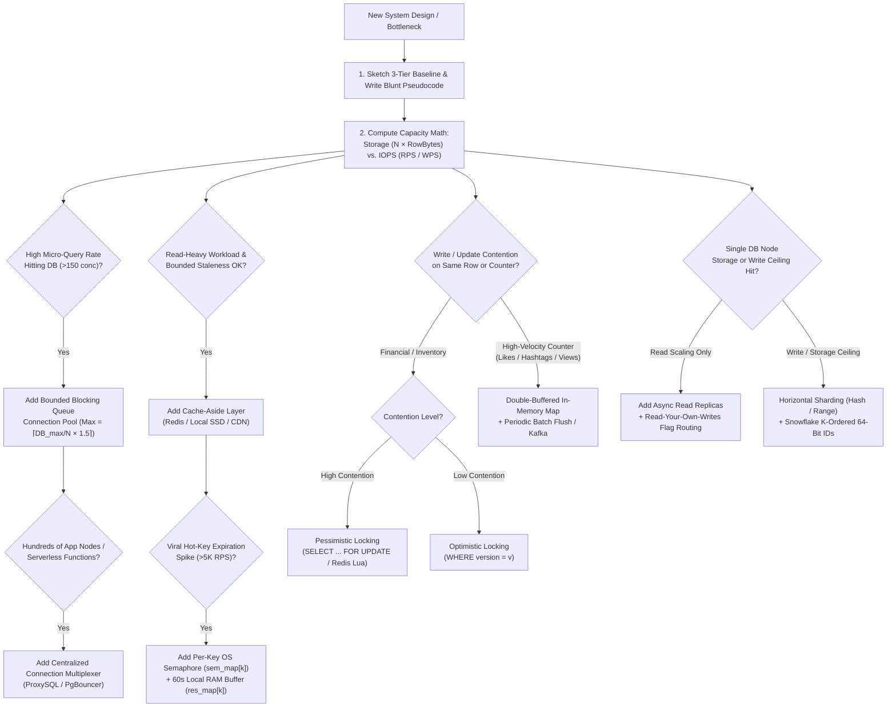

# System Design Master Brain — Principal Architect Reasoning Engine, Socratic Interrogator & 16-Module Pattern Playbook

> **How to Use This Document**:  
> Feed or attach this file (`SYSTEM_DESIGN_MASTER_BRAIN.md`) to any AI coding or architecture assistant (or load it as an agent skill). When given any system design problem, RFC, or production bottleneck, the AI must adopt the **Operating Protocol, Socratic Questioning Engine, Framework of Opposites, Decision-Flow Graphs, and 16-Module Lego-Block Playbook** defined below.

---

## PART I: CORE OPERATING PROTOCOL & THE SOCRATIC INTERROGATOR

### 1.1 The Prime Directive: Never Templatize, Always Evolve from First Principles
When asked to design, critique, or scale a system, **NEVER** dump a generic textbook diagram filled with premature distributed components (Kafka, ZooKeeper, Service Mesh, Multi-Region Active-Active) on Day 0. Instead, execute the **Six-Stage Sketch-to-Scale Loop**:

1. **Stage 1 — Start with the 3-Tier Baseline (`Client -> API Server -> Database`)**:
   - Every system starts as three simple boxes. Do not add a fourth box until you prove—via concrete code trace or back-of-the-envelope math—why the 3-tier baseline breaks.
2. **Stage 2 — Write Blunt Pseudocode & SQL First**:
   - Before drawing boxes, write the exact API signature (`POST /v1/...`), database schema (`CREATE TABLE ...`), SQL queries, and in-memory data structures. Writing 10 lines of blunt pseudocode exposes concurrency bugs, lock contention, and network round-trips that block diagrams hide.
3. **Stage 3 — Separate Storage Math from Compute/IOPS Math**:
   - Calculate **Total Storage Footprint** ($\text{Total Records} \times \text{Bytes per Record}$) and **Read/Write Throughput** ($\text{RPS}$ / $\text{WPS}$) separately. A dataset that is tiny in storage (e.g., $8\text{ GB}$ for $1\text{ Billion}$ rows) can still melt a database due to $200,000\text{ writes/sec}$ of connection/IOPS overhead.
4. **Stage 4 — Locate the Exact Bottleneck & Patch Minimally**:
   - Identify the single limiting resource (TCP handshakes, B+ tree page splits, disk random I/O, lock hold time, network scatter-gather, ephemeral ports) and apply the simplest targeted patch.
5. **Stage 5 — Audit Emergent Secondary Bottlenecks**:
   - Every architectural patch creates a new failure mode. Adding a cache introduces *Cache Stampedes*; adding soft deletes degrades *Index Scans*; adding sharding breaks *Cross-Shard Joins and Pagination*. Trace the side effect immediately.
6. **Stage 6 — Apply the "Single Engineer at 3:00 AM" Filter**:
   - Assume **one engineer** must implement, deploy, pay for, and debug this system at 3:00 AM. Always prefer OS primitives (semaphores, blocking queues, `epoll`, local filesystem) and constraint relaxation over adding another stateful distributed cluster.

---

### 1.2 The Socratic Interrogator: 10 Critical Questions to Ask Before Designing
Whenever a user presents a system design prompt, **interrogate the requirements** using these 10 first-principles questions (and if the user says *"you decide"*, explicitly state your quantified assumptions before proceeding):

1. **Quantify Every Subjective Adjective**:
   - Did the prompt use qualitative words like *"fast"*, *"real-time"*, *"long time"*, *"frequent"*, *"huge"*, or *"scalable"*?
   - **Rule**: Force a concrete number onto every adjective:
     - *"Real-time"* $\rightarrow$ Is $2\text{ms}$ required, or is $200\text{ms}$ / $5\text{s}$ acceptable? (Human eye perception threshold is $\approx 100\text{ms}$).
     - *"Offline after a long time"* $\rightarrow$ Is $\Delta_{\text{timeout}} = 3\text{s}$, $30\text{s}$, or $5\text{ minutes}$?
     - *"High throughput"* $\rightarrow$ Is it $1,000\text{ RPS}$, $50,000\text{ RPS}$, or $2,000,000\text{ RPS}$?
2. **What is the Read-to-Write Ratio and Payload Size?**:
   - Micro-reads/writes ($8\text{–}100\text{ bytes}$) behave completely differently from blob/document reads ($1\text{ MB–}100\text{ MB}$).
   - Capacity-billed cloud databases (e.g., DynamoDB billing $4\text{ KB}$ per RCU and $1\text{ KB}$ per WCU) waste $>99\%$ of billed capacity on unbatched $8\text{-byte}$ micro-payloads.
3. **Can We Batch at the Client, API, or Storage Layer? (Rule #1)**:
   - Can unary calls (`GET /item?id=1`) be replaced with batch calls (`POST /items [id1..idN]`)?
   - Can writes or deletes be buffered for $50\text{ms–}2\text{s}$ or executed in ordered batches (`ORDER BY id ASC LIMIT 100`)?
4. **What is the Exact Staleness & Consistency Tolerance?**:
   - Adopting a cache or read replica is an explicit contract to serve stale data.
   - Where is **Strong Consistency / Read-Your-Own-Writes** mandatory (e.g., bank balance, seat booking, creator seeing their own newly posted comment), and where is **Eventual Consistency** acceptable (e.g., public follower feed, like counters, presence dots)?
5. **What Happens Under Ungraceful Client, Network, or Node Death?**:
   - Never assume clients send graceful disconnect/logout events. Batteries die, cables are yanked, mobile networks drop, and processes suffer `SIGKILL` or power loss (leaving half-open TCP sockets, torn disk writes, or orphaned locks).
6. **Can We Relax a Global Constraint into a Local Constraint?**:
   - Instead of "strictly 1 cache hydration globally across 100 servers" (requiring distributed locks + busy-wait polling), can the database handle "1 hydration per API server" (using zero-cost local OS semaphores)?
   - Instead of exact global counters on every write, can we flush in-memory double-buffered maps every $5\text{ seconds}$?
7. **What is the Contention Profile (Low vs. High Contention)?**:
   - Are 10,000 users updating *their own* profile rows (zero contention), or are 10,000 users fighting for *the exact same* airline seat / flash-sale item / celebrity hashtag (extreme hot-key contention)?
8. **Is the Access Pattern Point Lookup, Range Scan, Prefix Match, Graph Traversal, or Full-Text?**:
   - Never pick a database by brand name; match the engine's underlying data structure (B+ Tree, LSM Tree, Inverted Index, Bitcask Hash Index, Columnar RLE, QuadTree/GeoHash, Adjacency Graph) to the query access pattern.
9. **What are the Operational, Team Familiarity, and Vendor Lock-In Constraints?**:
   - A 5-engineer startup optimizing for time-to-market should pay for managed services; a high-scale platform with dedicated SREs must evaluate cloud-agnostic open-source portability and per-request billing cliffs.
   - Team familiarity with a proven relational engine almost always beats adopting an unfamiliar distributed NoSQL store out of hype.
10. **What is the Blast Radius if This Component Goes Down?**:
    - Protect the primary transactional database at all costs—it is the most brittle, stateful component in the stack. Shed load, queue in bounded blocking pools, or degrade non-critical features rather than letting the primary DB crash.

---

## PART II: THE "FRAMEWORK OF OPPOSITES" GENERATOR MATRIX

Whenever you propose an architecture or write an engineering design document (RFC), systematically generate alternative designs by inverting each design dimension into its **Opposite Pole** and evaluating the trade-off:

| # | Architectural Dimension | Pole A | Opposite Pole B | Primary Decision Rule / Tiebreaker |
| :- | :--- | :--- | :--- | :--- |
| 1 | **Ingestion Direction** | **Push** (Client/Producer emits state) | **Pull** (Server/Consumer polls state) | Use **Push** when clients sit behind NAT/firewalls or state changes unpredictably; use **Pull** when consumers must control their own ingestion rate/backpressure (e.g., job pullers, Kafka consumers). |
| 2 | **State Representation** | **Dense** (1 record per entity globally) | **Sparse** (Records only for active entities) | Use **Dense** if historical metadata (*"Last seen at"*) is needed and total storage fits in budget ($8\text{B} \times 1\text{B} = 8\text{ GB}$); use **Sparse + TTL** if only active binary presence matters. |
| 3 | **Mutation Mode** | **In-Place Overwrite (`UPDATE`)** | **Append-Only Log (`INSERT`)** | Use **Overwrite** when only latest state matters; use **Append-Only** when audit trails, time-travel, or sequential disk write speed (Bitcask/LSM/WAL) is required. |
| 4 | **Expiration Ownership** | **Application Cron Reaper** | **Database Native TTL** | Use **DB Native TTL** (Redis `EXPIRE`) for simple key eviction; use **Application Staggered Batch Reapers** (`ORDER BY id LIMIT 100`) when purging relational B+ tree rows so you control load and batch size. |
| 5 | **Deletion Semantics** | **Hard Delete (`DELETE FROM`)** | **Soft Delete (`is_deleted = true`)** | Use **Soft Delete** on OLTP tables to avoid synchronous B+ tree multi-block rebalancing, enable 30-day user recovery, archive ML data to S3, and satisfy legal/law-enforcement audits. |
| 6 | **Coordination Scope** | **Global Exactly-Once State** (ZooKeeper / Distributed Lock) | **Relaxed Per-Server Local State** (In-Memory OS Semaphore) | Always check if relaxing from $1$ global operation to $M$ operations (1 per API server) is tolerable—eliminating distributed locks and network busy-waiting. |
| 7 | **Concurrency Control** | **Pessimistic Locking** (`SELECT FOR UPDATE` / Mutex) | **Optimistic Concurrency Control** (`version` column CAS retry) | Use **Pessimistic** under high contention or when retry cost is high (airline seat check-in, core ledger); use **Optimistic** under low contention with short transactions. |
| 8 | **Execution Coupling** | **Synchronous Inline RPC** | **Asynchronous Queue Delegation** | Execute **Inline** only what is strictly required to return a response to the user; offload side effects (emails, thumbnails, fan-out, analytics) to **Async Brokers** (Kafka/RabbitMQ). |
| 9 | **Storage Engine Tree** | **B+ Tree** (In-Place Page Updates, Read-Optimized) | **LSM Tree / Bitcask** (Append-Only SSTables + Compaction, Write-Optimized) | Use **B+ Trees** (MySQL/Postgres) for transactional reads and range scans; use **LSM/Bitcask** (Cassandra, Scylla, RocksDB) for extreme write throughput. |
| 10 | **Pagination Strategy** | **Offset Pagination** (`LIMIT M OFFSET N`) | **Cursor / Keyset Pagination** (`WHERE id > last_id LIMIT M`) | Never use `OFFSET` for deep pagination (forces DB to scan and discard $N$ rows); use **Cursor Pagination** for $O(\log N)$ B+ tree seek performance unless random page jumping is mandatory. |
| 11 | **Aggregation Timing** | **Read-Time Aggregation** (`COUNT(*)` on read) | **Write-Time / Buffered Pre-Aggregation** (In-memory flush / Materialized counter) | Never run `COUNT(*)` on hot reads; pre-aggregate on write using double-buffered in-memory maps + Kafka stream aggregators. |
| 12 | **Index Scope** | **Local Secondary Index** (Scoped to 1 Shard/Partition) | **Global Secondary Index** (Partitioned independently by indexed attribute) | Local indexes offer fast single-shard writes but require scatter-gather reads; Global indexes offer fast single-shard reads by secondary key but require distributed async dual-writes. |
| 13 | **Multi-Region Topology** | **Active-Passive** (Writes to Primary Region, Local Reads) | **Active-Active** (Multi-Master Writes + CRDT / Conflict Resolution) | Default to **Active-Passive** (writes go to primary region, reads served locally); avoid Active-Active unless cross-region write latency is a proven dealbreaker and conflict resolution is deterministic. |
| 14 | **Hosting Model** | **Self-Hosted Open Source** (Redis/Valkey/Postgres on VMs) | **Cloud-Managed Proprietary** (DynamoDB / Aurora / Spanner) | Weigh engineering headcount & ops toil against AWS/cloud vendor lock-in, RCU/WCU micro-payload billing traps, and competitor cloud policies. |

---

## PART III: MASTER DECISION-FLOW ROUTING ENGINE

When architecting any system, trace the request and data path through these connected decision flowcharts. Each node represents a concrete engineering check that routes to a specific architectural pattern:



---

## PART IV: THE 16-MODULE TECHNICAL PATTERN PLAYBOOK (EXTRACTED FROM ALL 16 SESSIONS)

## Module 01: Real-Time Presence, Connection Pooling, B+ Tree Storage Internals & Cache Stampede Coalescing

### 1.1 Online/Offline Presence Indicator at 1-Billion-User Scale
- **Problem**: Render online/offline status dots for a user's contact list and update presence in real time.
- **Iterative Evolution**:
  - *Read Path*: Unary `GET /status?user_id=X` is an anti-pattern (browsers cap concurrent connections per domain to **6 in Chrome, 8 in Firefox**). **Rule #1**: Batch into `POST /v1/statuses` accepting `user_ids[]` and executing a single batched `MGET`.
  - *Write Path (Push vs. Pull)*: Server cannot pull/ping clients behind NAT/firewalls without an established socket. Clients push `POST /v1/heartbeat` every $T_{\text{hb}} = 5\text{s}$ (or $10\text{s}$).
  - *Schema Evolution*: Storing `(user_id, is_online BOOLEAN)` fails when a client loses battery or unplugs its cable without sending an offline event. Quantify "long silence" to $\Delta_{\text{timeout}} = 30\text{s}$ and store `(user_id INT32/64, last_heartbeat EPOCH_INT32)`. Online check: `(now - last_heartbeat) <= 30`.
- **Capacity Math**:
  - *Storage*: $8\text{ bytes/user} \times 10^9\text{ users} = \mathbf{8\text{ GB}}$ ($16\text{ GB}$ for 64-bit). Storage is *never* the bottleneck.
  - *Compute/Write IOPS*: $10^6$ concurrent online users pushing every $5\text{s} = 12,000,000\text{ RPM} = \mathbf{200,000\text{ writes/sec}}$. Compute/IOPS is the bottleneck.
- **Dense vs. Sparse & Redis vs. DynamoDB (7-Axis Trade-Off)**:
  - *Dense (1B rows retained)* enables `"Last seen at..."`; *Sparse (per-key TTL `EX 30`)* stores only online users but loses last-seen timestamps upon eviction.
  - *Redis vs. DynamoDB*:
    1. **TTL Precision**: DynamoDB TTL eviction is eventually consistent (up to 48h background compaction delay); Redis expires keys within milliseconds via lazy + active sampling.
    2. **Micro-Payload Billing Trap**: DynamoDB bills per $4\text{ KB}$ RCU and $1\text{ KB}$ WCU—an $8\text{-byte}$ heartbeat wastes $99.2\%$ of each WCU, whereas self-hosted Redis has fixed VM cost.
    3. **Batch Scatter-Gather**: DynamoDB's single-digit ms SLA ($4\text{–}9\text{ms}$ P90) applies to single-item gets, *not* 1,000-key `BatchGetItem` scatter-gather calls.
    4. **Self-Healing & Durability**: With a $5\text{s}$ push interval, even an unpersisted Redis reboot self-heals $100\%$ of online statuses within $5\text{ seconds}$. If durability is needed, Redis provides **RDB snapshots + AOF write-ahead logging** (note: when Redis hits 100% RAM and evicts a key, it appends `DEL` to the AOF).
- **WebSockets & RFC 6455 Half-Open TCP Trap**:
  - **RFC 6455 (WebSocket spec)** does *not* mandate automatic heartbeats. If a remote machine loses power, no TCP `FIN` or `RST` is sent, leaving a **Half-Open (Single-Stranded / Orphaned) TCP Connection** until the server attempts a write and times out (`ECONNRESET`).
  - Libraries like Socket.IO or Gorilla WebSocket solve this at the application layer using `pingInterval`, `pingTimeout`, `reconnection`, `reconnectionAttempts`, and `reconnectionDelay`.
- **Pattern Reuse (Distributed Failure Detection)**:
  - Central/Leader-Follower: Replicas ping Master over gRPC; if silence $> \Delta$, trigger leader election.
  - Peer-to-Peer (P2P) Gossip Quorum: Used inside distributed databases/brokers (Redis Cluster, Valkey, Kafka KRaft) so the database does not depend on an external database (like ZooKeeper) to track its own nodes.

### 1.2 Bounded Blocking Queue Database Connection Pool
- **Problem**: Executing a $2\text{ms}$ micro-query by opening/closing a DB connection per request adds $8\text{–}12\text{ms}$ of overhead (TCP 3-Way Handshake `SYN/SYN+ACK/ACK` + MySQL Wire Auth Handshake + TCP 4-Way Teardown) and crashes MySQL with `Error 1040: Too many connections` when concurrency exceeds `max_connections` (151).
- **Architecture**:
  - Maintain a pre-warmed slice of persistent DB connections guarded by an OS-backed **Bounded Blocking Queue** (semaphore/channel of size `maxConn`).
  - `pool.Get()` pops a connection or blocks the calling thread in the OS kernel `Blocked Queue` (0% CPU) until `pool.Put()` returns a connection and signals the semaphore.
  - **Core Trade-Off**: Trades slightly higher queue wait time during bursts for **100% Database Stability (zero `5xx` crashes)**.
- **Elastic Sizing & Lifecycle Rules**:
  - Configure `min_connections` ($\approx 3\text{–}5$), `max_connections`, and `idle_connection_timeout`.
  - **Sizing Formula with Headroom**:
    $$\text{MaxConn}_{\text{per server}} = \left\lceil \frac{C_{\text{DB, max}}}{N_{\text{API servers}}} \times 1.5 \right\rceil$$
    *(The $1.5\times\text{–}2.0\times$ headroom multiplier prevents under-tuned pools from starving an underutilized database when traffic is uneven across servers).*
  - **Safe Connection Max-Lifetime (`TTL`) Eviction**: Never close a connection while an in-flight query is running. Check `now() > conn.expiresAt` strictly inside `pool.Put(conn)` *after* the query finishes.

### 1.3 B+ Tree Storage Internals, Soft Deletes (`is_deleted`) & Ordered Batch Reapers
- **Clustered vs. Heap Storage Layouts**:
  - **MySQL (InnoDB)**: The table *is* a Clustered B+ Tree on disk ordered by Primary Key (`id`). Internal routing nodes ($15\text{–}20$ branching factor) stay in RAM; leaf pages ($4\text{–}16\text{ KB}$ disk blocks) hold the full table rows sorted by PK. Secondary indexes are separate B+ trees storing `(indexed_col, primary_key)`.
  - **PostgreSQL**: Stores rows in an unordered **Heap File** on disk addressed by `ctid` (`block_num, tuple_offset`); all B+ tree indexes point to `ctid`, and dead tuples are reclaimed asynchronously by `VACUUM`.
- **Why Soft Delete (`is_deleted = true`) Beats Synchronous Hard Delete**:
  1. **Business/Legal Pillars**: (a) 30-day user trash recovery, (b) archiving deleted text to S3 for ML training, and (c) mandatory retention for law-enforcement/harassment audit investigations.
  2. **B+ Tree Physics**: A synchronous hard `DELETE` can cause leaf page underflow below `MERGE_THRESHOLD`, forcing the engine to acquire internal B+ tree node latches, borrow/merge keys across sibling pages, and rewrite **3 to 15+ disk blocks** inside the transaction scope. A soft delete (`UPDATE ... SET is_deleted = true`) rewrites **1 disk block in-place** with zero tree rebalancing.
- **Staggered Ordered Batch Reaper**:
  - Purge expired soft-deleted rows via an application-controlled job (never an unbounded `DELETE` or internal DB event):
    ```sql
    DELETE FROM table_name WHERE is_deleted = TRUE ORDER BY id ASC LIMIT 100;
    ```
  - Ordering by `id ASC` targets co-located rows on the same B+ tree leaf pages, collapsing deletions into a single localized rebalance without long lock holds.
- **Composite Index Column Ordering Rule**:
  - For queries like `SELECT * FROM users WHERE is_deleted = false ORDER BY email ASC`, always create `INDEX(is_deleted, email)`—**equality predicate first, sort/range column second**—so all active rows sit contiguously in sorted email order (avoiding full index scans or slow single-column Index Merge row-ID set intersections).

- **Why Request Deduplication Wait Buffers Fail in Production**:
  - *Alternative Considered*: Buffer all incoming requests in a 50ms queue and deduplicate identical query keys.
  - *Fatal Flaw*: When traffic drops, non-stampeding requests are penalized with an artificial 50ms latency penalty waiting for a buffer that never fills. The Single-Flight Semaphore pattern guarantees the first request proceeds instantly with zero artificial latency.

### 1.5 Module 01 Critical Hidden Edge Cases & Failure Modes (Session 01)
- **1. In-Flight Connection Eviction Race**: If a database connection in the pool exceeds its `max_lifetime` while actively executing a 2-second query, closing it asynchronously will abort the query with `Error: connection lost during query` and return a 5xx to the user. **Rule**: Check expiration timestamps *strictly* inside `pool.Put(conn)` after execution finishes.
- **2. Silent TCP Drop & Non-Idempotent Write Retry Trap**: When an idle database connection is silently terminated by an intermediate NAT firewall or MySQL `wait_timeout`, the next query fails with `broken pipe` or `connection reset by peer`. **Rule**: Automatically retry once *only* if the statement is a pure idempotent `SELECT`; never automatically retry non-idempotent `INSERT` or `UPDATE` statements without an explicit idempotency token, as the write may have already committed on the primary.
- **3. Soft Delete Unbounded Purge Disaster**: Executing `DELETE FROM users WHERE is_deleted = true` in a background DB event without limits locks large swathes of B+ tree leaf pages, exhausts the InnoDB undo log (`history list length`), and starves active user transactions. Purges must run as an application-controlled job: `DELETE FROM users WHERE is_deleted = true ORDER BY id ASC LIMIT 100`.

### 1.4 Cache Stampede (Thundering Herd) & Per-Key Semaphore Coalescing
- **First-Principles Caching Law**: Caching is a Space-vs.-Time + **Explicit Staleness** trade-off across RAM, SSD, or CDN edge to avoid repeating expensive compute or slow I/O.
- **The Stampede Failure Mode**: When a hot cache key `k` expires under a $10,000\text{ RPS}$ spike, all $10,000$ threads simultaneously see `cache.get(k) == nil` and storm the primary database with $10,000$ identical SQL queries.
- **Relaxing Global to Local Coalescing (`sem_map` + `res_map`)**:
  - *Avoid* global distributed locks (ZooKeeper/Redis lock) where $9,999$ threads busy-wait poll the lock store.
  - *Relax the constraint*: Allow at most **1 DB hydration query per API server** ($M$ queries total for $M$ servers) using two local thread-safe structures:
    1. **`sem_map[k]` (Mutex-Guarded Per-Key Semaphore)**: The first thread on the server atomically registers `sem_map[k]` and queries the DB; the other $999$ threads on that server call `wait()` and sleep in the OS kernel `Blocked Queue` (0% CPU).
    2. **`res_map[k]` (60-Second Local RAM Buffer)**: Before calling `signal()` to wake the $999$ sleeping threads, the leader stores the fetched value in `res_map[k]` with a 60s local TTL. Waking threads read `res_map[k]` directly from process RAM—preventing a secondary $999\text{-request}$ network stampede against Redis! Checking `res_map[k]` at line 1 of `get_blog(k)` also short-circuits subsequent requests on that server for 60 seconds.

## Module 02: Database Scaling, ProxySQL Wire-Protocol Routing, Async Delegation (SQS vs. Kafka), and Real-Time Streaming (Polling, WebSockets, SSE)

### 2.1 Core Architectural Axioms
1. **Scaling Definition**: Scaling is NOT about handling a large total number of requests; it is about handling a large number of **concurrent** requests.
2. **Bottom-Up Scaling Rule**: Always scale **bottom-up** (Database / stateful dependencies first $\rightarrow$ stateless API servers $\rightarrow$ Load Balancer), never top-down. Scaling stateless compute without scaling the database merely amplifies load against the downstream bottleneck.
3. **People Collaboration Cost > Infrastructure Cost**: Decoupling heterogeneous background side effects via append-only streams (Kafka) solves organizational friction (preventing two engineering teams from editing and breaking a single shared worker codebase) as much as technical coupling.

### 2.2 Database Read/Write Scaling & ProxySQL Architecture
- **Iterative Evolution**:
  - **Attempt 1 (Single Node Vertical Scaling)**: Handles `< 50,000` users on a single machine (`1 GB` $\rightarrow$ `4 GB RAM`). Fails when read traffic (`80%–95%` of workload) saturates IOPS or write volume exceeds 1 node.
  - **Attempt 2 (Master + Read Replicas with App-Level Dual Connection Pools)**: App holds `master_db` and `replica_db` pools.
    - *Bottleneck*: Leaks DB topology into application code; adding/removing replicas or decomposing a monolith requires app redeployments; lacks centralized connection multiplexing.
  - **Attempt 3 (ProxySQL Wire-Protocol Proxy — Production Design)**:
    - ProxySQL sits between API servers and MySQL clusters, speaking the native **MySQL Wire Protocol** on the frontend and maintaining multiplexed connection pools grouped into **Hostgroups** (`HG 10` = Master, `HG 20` = Read Replicas) on the backend.
    - **Why Standard Load Balancers (ALB/NLB/Nginx) Cannot Replace ProxySQL**: Standard L4/L7 load balancers do not understand the stateful MySQL Wire Protocol, cannot inspect individual SQL statements inside a persistent multiplexed TCP session, and cannot route per-query regexes.
- **ProxySQL Admin Configuration & Semantic Comment Routing**:
  ```sql
  -- 1. Register Primary (HG 10) and Read Replicas (HG 20)
  INSERT INTO mysql_servers (hostgroup_id, hostname, port) VALUES (10, 'primary_ip', 3306);
  INSERT INTO mysql_servers (hostgroup_id, hostname, port) VALUES
      (20, 'replica1_ip', 3306), (20, 'replica2_ip', 3306), (20, 'replica3_ip', 3306);
  LOAD MYSQL SERVERS TO RUNTIME;
  SAVE MYSQL SERVERS TO DISK;

  -- 2. Semantic SQL Comment Routing (Best Practice via ORM Middleware, avoids leaking Hostgroup IDs)
  SELECT /* read */ * FROM users WHERE id = 42;   -- Matched by '/\* read \*/' -> Routed to HG 20 (Replica)
  SELECT /* write */ * FROM users WHERE id = 42;  -- Matched by '/\* write \*/' -> Routed to HG 10 (Master)
  ```
- **ProxySQL Benchmarks & Mechanics**:
  - **Hostgroup Load Balancing**: Routes to the backend server with the **least number of currently active (in-use) connections**.
  - **Latency Overhead**: `~3 ms` added hop vs. `50–60 ms` typical query execution time; evaluates up to `500 regex rules` in `mysql_query_rules` with negligible CPU impact.
  - **Zero-Downtime Monolith Decomposition**: Stand up a new `payments_db` hostgroup, replicate tables, and add a ProxySQL rule matching `schemaname = 'payments'` (or table regex) to cut over traffic with **zero application code changes**.

### 2.3 Sharding Ownership Spectrum
| Strategy | Metadata Overhead | Granular Control | Resharding Cost |
| :--- | :--- | :--- | :--- |
| **Hash Sharding (`hash(key) % N`)** | Near-zero ($O(1)$ formula) | Zero (cannot pin a specific user) | High (unless Consistent Hashing used) |
| **Range Sharding (`A–J`, `K–T`)** | Moderate (range boundary table) | Medium (range splits) | Low (split/merge ranges) |
| **Static Key-Level Mapping (`key -> shard_id`)** | High (1 row per key in lookup store) | **100% fine-grained placement** | Minimal (migrate 1 key and flip mapping) |

### 2.4 Asynchronous Delegation: Message Queues (SQS) vs. Message Streams (Kafka)
- **The Multi-Feature Worker Trap on SQS**:
  - Suppose publishing a blog needs to (1) increment `total_blogs` in MySQL and (2) index the blog in Elasticsearch.
  - If a single SQS worker performs both steps and step 2 fails, SQS redelivers the message after the visibility timeout and **double-increments `total_blogs`**. Furthermore, two separate teams (Core Backend & Search) are forced to deploy the same worker repo.
- **Production Solution (Kafka Partitioned Topic + Independent Consumer Groups)**:
  - Publish once to `on_publish` topic partitioned by `hash(user_id) % P`.
  - **Core Backend Consumer Group** and **Search Consumer Group** maintain independent offsets on the append-only partition logs.
  - **Ordering Guarantee**: Strictly ordered **within a partition** (per `user_id`), never globally across partitions.
  - **Why Kafka Partitions Can Never Be Reduced**: Each partition is an immutable append-only disk file ordered by offset; removing a partition and merging its historical messages into remaining partitions while preserving per-key chronological order would require inserting into the middle of immutable append-only files.
  - **Hot Partition Mitigation**: If 1 partition receives `100x` traffic and ordering is not required, have that partition's consumer thread push messages directly into an elastic **SQS queue** and commit the offset, letting auto-scaled SQS workers drain the spike in parallel.

### 2.5 Real-Time Communication & Live Deployment Log Streaming (Netlify/Vercel Clone)
- **SSE vs. WebSockets Memory Benchmark**:
  - In a multi-step streaming pipeline (~20s duration per user, Python worker capped at `100 MB RAM` on a `1 GB RAM` node), **WebSockets consumed `8x` more RAM per concurrent connection than Server-Sent Events (SSE)**.
  - **Rule**: Whenever real-time streaming is strictly **unidirectional (Server $\rightarrow$ Client)**—such as CI/CD deployment logs, AI token streaming, or live status trackers—always choose **SSE (`Content-Type: text/event-stream`, `Transfer-Encoding: chunked`)** over WebSockets.
- **SSE Log Streaming Architecture**:
  - `POST /deployments` spawns background worker writing `timestamp: log_line` to `dataset/logs/{uuid}.log` flushing every `0.5s`, and returns `301 Redirect` to `/deployments/{uuid}`.
  - Browser connects via `new EventSource("/logs/" + uuid)`.
  - Server streams via a generator calling `fp.readline()` in a loop, yielding `f"data: {line}\n\n"` and sleeping `0.1s` on EOF (`if not line`).

### 2.6 Module 02 Critical Hidden Edge Cases & Failure Modes (Session 02)
- **1. Read-After-Write Trap on ProxySQL & Replication Lag**: If an app executes `INSERT INTO orders` (Hostgroup 10) and immediately `SELECT * FROM orders WHERE id = ...` (routed by `^SELECT` to Read Hostgroup 20), replication lag causes a `404`! Fix: (a) Annotate read-after-write queries with `/* write */` or set `transaction_persistent = 1` in ProxySQL; (b) Pin user session reads to Primary for $T = 5\text{–}10\text{s}$ following writes; or (c) Compare client GTID cookie against `replica.applied_gtid`.
- **2. Poison Pill Messages in Kafka / SQS**: A corrupted payload causes the consumer worker to crash repeatedly upon processing. The uncommitted message is redelivered in an infinite crash loop, freezing the entire partition. **Fix**: Implement a `receive_count` threshold ($\le 3$). After 3 consecutive crashes, route the poison pill message to a **Dead Letter Queue (DLQ)** along with the stack trace, emit a P2 pager alert, and commit the offset to resume stream processing.
- **3. Kafka Consumer Group Rebalance Storm**: If a consumer thread stalls on a slow downstream microservice and exceeds `max.poll.interval.ms` (default 300,000ms / 5 min), Kafka's Group Coordinator evicts the consumer as dead and triggers an **Eager Rebalance**, pausing message consumption across ALL partitions in the group. **Fix**: Decouple ingestion from processing by reading from Kafka into an internal bounded worker pool, and configure `partition.assignment.strategy = CooperativeStickyAssignor` so unaffected partitions continue streaming without disruption.
- **4. Cross-Region Replica Saturation**: Never have 6 replicas in `eu-west-1` pull WAL streams across the ocean from a single Master in `us-east-1`. Use a **Cascading / Relay Replica** in `eu-west-1` that pulls once from `us-east-1` and serves the other 5 local replicas.
- **5. Mobile Battery & DOM Thrashing on High-Frequency Tickers**: (1) Heavy `gzip` compression on sub-second WebSocket tickers overheats mobile CPUs due to continuous decompression; (2) Appending unbounded SVG/DOM nodes crashes the browser tab—use HTML5 `<canvas>` and evict off-viewport points.
- **Read-After-Write Trap on ProxySQL**: If an app executes `INSERT INTO orders` (HG 10) and immediately `SELECT * FROM orders WHERE id = ...` (routed by `^SELECT` to HG 20), replication lag causes a `404`! Fix: annotate read-after-write queries with `/* write */` or set `transaction_persistent = 1`.
- **Cross-Region Replica Saturation**: Never have 6 replicas in `eu-west-1` pull WAL streams across the ocean from a single Master in `us-east-1`. Use a **Cascading / Relay Replica** in `eu-west-1` that pulls once from `us-east-1` and serves the other 5 local replicas.
- **Mobile Battery & DOM Thrashing on High-Frequency Tickers**: (1) Heavy `gzip` compression on sub-second WebSocket tickers overheats mobile CPUs due to continuous decompression; (2) Appending unbounded SVG/DOM nodes crashes the browser tab—use HTML5 `<canvas>` and evict off-viewport points.

---

## Module 03: Pessimistic Locking (`FOR UPDATE`, `SKIP LOCKED`, `NOWAIT`), Optimistic Concurrency Control (OCC), and Distributed KV Store on Relational DB

### 3.1 Core Architectural Axioms
1. **Universal Contention Formula**:
   $$\text{Fixed Inventory} + \text{High Contention} = \text{Locking}$$
   Applies identically to Airline Web Check-In, Concert/Train Ticketing, Vaccine Slot Booking, Flash Sales, and DB-backed Task Queues.
2. **Implicit Transaction Rule**: Every standalone SQL statement (`INSERT`, `UPDATE`, `DELETE`, `SELECT`) executes inside an implicit transaction. Wrapping a single statement in `START TRANSACTION; ... COMMIT;` wastes **2 extra network round-trips** (3 RTTs vs. 1 RTT) and extends lock hold duration.
3. **Compute-Storage Separation**: Cloud providers build "new" databases (e.g., DocumentDB, Neptune, or an HTTP KV store) by placing a stateless protocol-translation compute layer in front of a battle-tested relational storage engine (Aurora / MySQL / PostgreSQL).

### 3.2 Airline Web Check-In System (120 Seats, 120 Concurrent Users)
- **Schema**: `seats (id INT PK, name VARCHAR(10), trip_id INT, user_id INT NULL)` initialized with 120 rows (`1A..20F`, `user_id = NULL`).
- **Iterative Evolution & Benchmarks**:
  1. **Attempt 1 (No Locking inside Transaction)**:
     ```sql
     START TRANSACTION;
     SELECT id FROM seats WHERE trip_id = 1 AND user_id IS NULL ORDER BY id LIMIT 1;
     UPDATE seats SET user_id = ? WHERE id = ?;
     COMMIT;
     ```
     - *Failure*: **Only 2 to 4 seats out of 120 are booked!** Concurrent transactions read `seat_id = 1` before commits occur and overwrite `seat_id = 1` (Lost Update anomaly), leaving 116+ passengers unassigned.
  2. **Attempt 2 (Blocking Pessimistic Lock — `FOR UPDATE`)**:
     ```sql
     SELECT id FROM seats WHERE trip_id = 1 AND user_id IS NULL ORDER BY id LIMIT 1 FOR UPDATE;
     ```
     - *Internal DB Mechanics*: Transaction 1 locks `1A`; the other 119 transactions block. When Transaction 1 commits, InnoDB wakes the blocked transactions, **implicitly re-evaluates `WHERE user_id IS NULL`**, sees `1A` is no longer `NULL`, and advances all 119 contenders to `1B` ($119 + 118 + \dots + 1$ serialized lock handoffs!).
     - *Benchmark*: All 120 seats uniquely assigned in **`538 ms`**.
  3. **Attempt 3 (Non-Blocking Pool Allocation — `FOR UPDATE SKIP LOCKED`)**:
     ```sql
     SELECT id FROM seats WHERE trip_id = 1 AND user_id IS NULL ORDER BY id LIMIT 1 FOR UPDATE SKIP LOCKED;
     ```
     - *Internal DB Mechanics*: Treats `row IS NOT LOCKED` as an additional filter predicate. Contenders immediately skip locked rows and lock `1A, 1B, 1C...` in parallel.
     - *Benchmark*: All 120 seats uniquely assigned in **`99 ms–136 ms`** (**`4x–5x` faster than `FOR UPDATE`**).

### 3.3 The Complete Locking & Concurrency Decision Matrix
| Scenario | Mechanism | SQL / Implementation Pattern | Why |
| :--- | :--- | :--- | :--- |
| **Auto-assign any item from a pool** (Free check-in, Job queue puller, Flash sale unit claim) | `FOR UPDATE SKIP LOCKED` | `SELECT ... WHERE user_id IS NULL ORDER BY id LIMIT 1 FOR UPDATE SKIP LOCKED` | Zero blocking; parallel workers grab distinct items in $O(1)$ lock pass. |
| **User clicks specific item (`Seat 14A`), 1-step instant claim** | `FOR UPDATE NOWAIT` | `SELECT ... WHERE id = 14 AND user_id IS NULL FOR UPDATE NOWAIT` | 1 user wins; 119 fail immediately with `MySQL Error 3572` instead of hanging. |
| **Specific row mutation where callers must wait in line** (Wallet balance transfer) | `FOR UPDATE` (Wait) | `SELECT balance FROM accounts WHERE id = ? FOR UPDATE` | Serializes mutations on the exact target row without aborting callers. |
| **Multi-step user flow with think-time / external payment** (Select seat $\rightarrow$ 5-min payment) | **TTL Reservation + Optimistic Concurrency Control (OCC)** | `UPDATE seats SET user_id = ?, version = version + 1 WHERE id = ? AND version = ?` | Never hold a DB transaction across user think-time or HTTP calls; OCC avoids long-lived DB locks. |

### 3.5 Module 03 Critical Hidden Edge Cases & Failure Modes (Session 03)
- **1. Unindexed `FOR UPDATE` Lock Escalation Disaster**: If a query executes `SELECT ... FOR UPDATE` where the `WHERE` clause does not hit a unique index (or optimizer falls back to table scan), InnoDB locks **every single row and index gap** in the table with exclusive locks, effectively escalating to a **Full Table Lock** and halting all concurrent transactions globally!
- **2. Deadlock Detection & Automated Victim Rollback**: When Transaction 1 (holds Row A, wants Row B) and Transaction 2 (holds Row B, wants Row A) deadlock, the engine's background cycle-detection thread scans the **Wait-For Graph (WFG)**. MySQL automatically terminates and rolls back the transaction with the fewest modified rows, throwing **`Error 1213: Deadlock found when trying to get lock; try restarting transaction`**. Application database clients must explicitly catch `Error 1213` and retry with randomized exponential backoff.
- **3. `NOWAIT` vs. `SKIP LOCKED` Failure Semantics**: `SELECT ... FOR UPDATE NOWAIT` aborts immediately with **`Error 3572: Statement aborted because lock(s) could not be acquired immediately`**—essential when a user clicked a specific seat (Seat 14B) to provide instant feedback. In contrast, `SKIP LOCKED` bypasses locked rows without waiting—essential for pool allocations (worker queues, flash sale units).
- **4. S3 Multipart Upload Abandonment Billing Leak**: When a client initiates a multipart upload via presigned URLs and drops offline, AWS S3 preserves all uploaded parts indefinitely and continues billing for storage. Every S3 bucket must enforce an S3 Lifecycle Rule: **`AbortIncompleteMultipartUpload` after 7 days**.

### 3.4 Distributed Key-Value Store on MySQL (`GET`, `PUT`, `DELETE`, TTL)
- **Schema & Single-Column State Encoding**:
  ```sql
  CREATE TABLE store (
      `key` VARCHAR(255) PRIMARY KEY,
      `value` TEXT,
      `expired_at` BIGINT NULL,
      INDEX idx_expired_at (expired_at)
  );
  ```
  - **Encoding**: `expired_at IS NULL` $\rightarrow$ never expires; `expired_at = 0` $\rightarrow$ **soft-deleted**; `expired_at > 0` $\rightarrow$ Unix epoch expiration timestamp.
  - **Why No Separate `is_deleted` Column**: Avoids a second index and avoids an expensive disjunctive `WHERE expired_at < NOW() OR is_deleted = 1` query in the cleanup cron.
- **High-Throughput SQL Operations**:
  - **`PUT(k, v, ttl)` (`32x` faster than `REPLACE INTO`, 1 network RTT)**:
    ```sql
    INSERT INTO store (`key`, `value`, `expired_at`) VALUES (?, ?, ?)
    ON DUPLICATE KEY UPDATE `value` = VALUES(`value`), `expired_at` = VALUES(`expired_at`);
    ```
    *(Why `REPLACE INTO` is `32x` slower: on key collision, `REPLACE INTO` executes a physical `DELETE` + `INSERT`, triggering B+ Tree leaf deletion and rebalancing instead of an in-place update).*
  - **`GET(k)` (Push TTL filter to DB, project only `value`)**:
    ```sql
    SELECT `value` FROM store WHERE `key` = ? AND (`expired_at` IS NULL OR `expired_at` > UNIX_TIMESTAMP());
    ```
  - **`DELETE(k)` (Micro-optimized conditional soft-delete — avoids lock/write if already expired/deleted)**:
    ```sql
    UPDATE store SET `expired_at` = 0
    WHERE `key` = ? AND (`expired_at` IS NULL OR `expired_at` > UNIX_TIMESTAMP());
    ```
  - **Batched Background Garbage Collector Cron (Always use `LIMIT`)**:
    ```sql
    DELETE FROM store WHERE `expired_at` IS NOT NULL AND `expired_at` < UNIX_TIMESTAMP() LIMIT 1000;
    ```
- **3 Strategies for Read-Replica Consistency in the KV Store**:
  1. **Redis Sticky Key TTL**: On `PUT(k)`, write `k` to Redis with `TTL = 15s` (max expected lag). If `k` is in Redis on `GET(k)`, route to Master; else Replica.
  2. **Deterministic GTID / LSN Tracking**: Store `k -> master_GTID` in Redis on write; poll each Replica's applied `GTID` every `3s`; route to Replica only if `replica_GTID >= key_GTID`.
  3. **Client-Controlled `consistent_read=true` Flag + Pricing Throttle (DynamoDB Model)**: Charge `3x–4x` more for `consistent_read=true` (routed to Master) so clients self-throttle strong reads.

---

## Module 04: Non-Relational Internals (Columnar, Graph, Wide-Column) & Slack Real-Time Messaging Architecture

### 4.1 Non-Relational Database Selection & Internals
- **Column-Oriented Stores (ClickHouse, Redshift, BigQuery)**:
  - Store each column in a contiguous file segment stitched by virtual row offsets.
  - Ideal for OLAP aggregations (`AVG(salary)`) scanning a few columns across millions of rows; enables high-ratio homogeneous compression (**Run-Length Encoding [RLE]** and bit-packing).
- **Graph Databases (Neo4j, Neptune, TigerGraph, DGraph)**:
  - Store direct physical neighbor pointers on each node record ($O(1)$ hop traversal).
  - **3 Valid Use Cases**: (1) Multi-hop pathfinding; (2) Collaborative filtering recommendations (missing edge detection); (3) **Real-Time Banking Fraud Detection** (checking within **`120–200 ms` P95** in TigerGraph whether a user node shares an edge with historical currency/amount bracket segment nodes before approving a wire transfer).
  - **4 Strict Anti-Patterns Where Graph DBs Fail**:
    1. **Deep Pagination (`> 1,000` nodes)**: Social follower lists (`1M` followers) degrade exponentially past `1,000` items; store follower edges in Relational/Wide-Column DBs instead.
    2. **Write-Heavy Supernodes**: Mutating a node with `10,000` edges updates `10,000` neighbor pointer lists.
    3. **OLAP Aggregations (`SUM`, `COUNT`, `AVG`)**.
    4. **Horizontal Sharding Across Network Nodes**: Cross-machine pointer hops kill latency; Graph DBs scale vertically with massive RAM.
- **Wide-Column Stores (Cassandra, ScyllaDB, DynamoDB)**:
  - Partitioned across a consistent hashing ring by **Partition Key (Hash Key)** and sorted on disk within each partition by **Clustering Key (Sort/Range Key)**.
  - **LSI vs. GSI / Dual-Write Rule**: Querying by an attribute without the Partition Key using a Local Secondary Index (LSI) triggers a **50-node scatter-gather across the entire cluster**. Always maintain a separate Global Secondary Index (GSI) or dual-write to a second query table keyed by the target attribute.

### 4.3 Module 04 Critical Hidden Edge Cases & Non-Relational Traps (Session 04)
- **1. Graph DB Celebrity Supernode Explosion**: In graph databases (Neo4j, Neptune), a celebrity node with 10M edges stores 10M physical memory pointers inside its record. Traversing or modifying this node triggers multi-second JVM Garbage Collection pauses and pointer-chasing memory thrashing. Graph DBs must NEVER be used for 1-to-N social follower lists; they are strictly for dense, bounded multi-hop subgraphs (e.g. fraud rings, corporate ownership).
- **2. Cassandra Tombstone Overload (`TombstoneOverwhelmingException`)**: In wide-column stores (Cassandra/ScyllaDB), deleting a row appends a **Tombstone** marker. When a query scans a partition containing thousands of deleted items, reading tombstones consumes massive CPU. If tombstone count exceeds `tombstone_failure_threshold` (default 100,000), Cassandra crashes the query with `TombstoneOverwhelmingException`! Use time-partitioned tables (e.g., daily tables) and execute `DROP TABLE` to instantly reclaim disk without generating tombstones.
- **3. Linux OS Kernel Tuning for 100k+ Naked WebSocket Nodes**: To support 100,000 persistent sockets per server without kernel panics:
  - File Descriptors: Set `fs.file-max = 2097152` and `/etc/security/limits.conf` (`* soft nofile 1048576`, `* hard nofile 1048576`).
  - Socket Backlog: Set `net.core.somaxconn = 65535` and `net.ipv4.tcp_max_syn_backlog = 65535`.
  - TCP Buffer Memory Tuning: Set `net.ipv4.tcp_rmem = 4096 87380 4194304` (minimum 4KB, default 87KB) and `net.ipv4.tcp_wmem = 4096 65536 4194304` so 100k idle sockets consume $\sim 400\text{ MB}$ of RAM rather than tens of gigabytes.

### 4.2 Slack Real-Time Text Communication Architecture
- **1. The Unified Channel Schema (Eliminating the Bidirectional DM `OR` Trap)**:
  - *Anti-Pattern*: Storing `messages(sender_id, receiver_id)` forces DM history queries to run `WHERE (sender_id = A AND receiver_id = B) OR (sender_id = B AND receiver_id = A)`, causing dual index scans and set union overhead, plus separate logic for group channels.
  - *Production Pattern*: **A 1-on-1 DM is simply a Channel with 2 members and `type = 'DM'`!**
    ```sql
    CREATE TABLE channels (id BIGINT PRIMARY KEY, name VARCHAR(255) NULL, type ENUM('DM', 'CHANNEL') NOT NULL);
    CREATE TABLE membership (channel_id BIGINT, user_id BIGINT, PRIMARY KEY (channel_id, user_id), INDEX idx_user (user_id));
    CREATE TABLE messages (
        id BIGINT PRIMARY KEY,
        channel_id BIGINT NOT NULL, -- Shard Key!
        sender_id BIGINT NOT NULL,
        thread_id BIGINT NULL,      -- Self-references messages.id for 1-level threads
        message TEXT NOT NULL,
        created_at BIGINT NOT NULL,
        INDEX idx_channel_created (channel_id, created_at DESC)
    );
    ```
  - Sharding `messages` by `channel_id` guarantees all DM and channel history queries hit a single shard via a single B+ Tree index scan (`WHERE channel_id = ? AND thread_id IS NULL ORDER BY created_at DESC LIMIT 20`).
- **2. Protocol Split & Persistence Guarantees**:
  - **Historical Pagination**: Standard **HTTP REST** (`GET /channels/{id}/messages`). Never multiplex request-response pagination over WebSockets (avoids head-of-line blocking and reinventing HTTP request correlation).
  - **Persistence vs. Delivery Spectrum**:
    - **B2B (Slack)**: HTTP `POST` saves to `Messages DB` *before* publishing to Redis Pub/Sub / WebSockets (Persistence > Latency).
    - **B2C (Telegram)**: Pushes over WebSocket immediately and persists asynchronously, relying on client-side SQLite cache.
    - **Ephemeral (In-call Meet/Zoom chat)**: Broadcasts only to connected sockets with zero DB storage.
- **3. WebSocket Server (WSS) DMZ Isolation & Redis Pub/Sub Bus**:
  - **DMZ Security Rule**: Public-facing `WSS` nodes must **never** hold DB credentials or network routes to `Messages DB` or `Membership DB` (mitigates RCE blast radius like Log4j). `WSS` communicates strictly with internal stateless `Message Service` and `Membership Service`.
  - **In-Memory Local Channel Map**: Each `WSS` holds `local_channel_membership_map = {channel_id: [connected_user_ids_on_this_wss]}`.
    - *Memory Math*: $50,000\text{ users} \times 10\text{ channels/user} \times 4\text{ bytes} \approx \mathbf{2\text{ MB RAM}}$ per WSS node!
  - **Bus Topology**: Instead of an $O(N^2)$ full mesh between WSS nodes, each WSS subscribes to **Redis Pub/Sub** only for channels present in its `local_channel_membership_map`.
- **4. Breaking the 65,536 Ephemeral Port Wall via Naked WSS + Connection Balancer**:
  - **Why Reverse Proxies / Load Balancers Cap WebSockets at 65,536**:
    - A TCP connection is identified by the 5-tuple: $(\text{Src IP}, \text{Src Port}, \text{Dst IP}, \text{Dst Port}, \text{Protocol})$.
    - Between a Reverse Proxy IP and a Backend WSS IP, `Src IP`, `Dst IP`, `Dst Port`, and `Protocol` are all fixed—leaving only the 16-bit `Src Port` ($2^{16} = \mathbf{65,536}$) to distinguish connections!
  - **Production Solution (Naked WSS + HTTP Connection Balancer)**:
    - Expose `WSS` nodes **directly on public IPs** (client `Src IP`s vary across 4.3 billion IPv4 addresses, enabling **5,000,000+ concurrent connections** on a single vertically scaled server).
    - Clients first call `GET https://balancer.slack.com/connect?org_id=acme` ($\approx 115\text{ RPS}$ for 1M DAUs reconnecting 10x/day).
    - The Connection Balancer looks up a static mapping table (`org_id -> [WSS_IP_1, WSS_IP_2]`) to **collocate all employees of an enterprise onto 1–2 WSS nodes**, minimizing Redis Pub/Sub fan-out and allowing dedicated hardware isolation for premium tenants.
- **5. Mention Deduplication on Message Edit**:
  - On `PATCH /messages/{id}`, compute the **set difference** `new_mentions - old_mentions` so previously tagged `@users` are not spammed with duplicate notifications when a typo is fixed.

---

## Module 05: High-Availability Regional L7 Load Balancer & Remote vs. Distributed Locks (Redlock)

### 5.1 Core Architectural Axioms
1. **True Purpose of a Load Balancer**: Abstracting out **infrastructure elasticity** behind a single stable entry point so clients never know whether 2 or 200 backend servers are running.
2. **Recursive Elasticity Abstraction**: Whenever a layer becomes elastic ($1 \rightarrow N$ Backend Servers; $1 \rightarrow M$ Load Balancers), introduce a higher abstraction layer above it ($N$ Backends $\rightarrow$ LB; $M$ LBs $\rightarrow$ DNS + VRRP/ECMP + Anycast BGP).
3. **Synchronization Medium Hierarchy**:
   - Across **Threads** (same process) $\rightarrow$ **RAM** (Mutex / Semaphore).
   - Across **Processes** (same OS) $\rightarrow$ **Local Disk** (`/var/lib/dpkg/lock`).
   - Across **Machines** $\rightarrow$ **Network** (**Remote Lock** = 1 authority node; **Distributed Lock** = $N$ independent authority nodes with majority quorum).

### 5.2 Regional L7 Load Balancer Architecture (Day-0 to Multi-Region HA)
- **1. Core Data-Plane Forwarding Loop (Go TCP/HTTP Proxy)**:
  - Accepts `srcConn`, selects backend via Round-Robin/Least-Connections from **local in-memory config cache**, dials `dstConn`, and spawns **two non-blocking goroutines** (`go io.Copy(dstConn, srcConn)` and `go io.Copy(srcConn, dstConn)`).
- **2. Control Plane Config Propagation (Hybrid Push + Pull with Monotonic Version Guard)**:
  - **Push**: `LB Control Plane API` writes to transactional `Config DB` and publishes to **Redis Pub/Sub** for sub-millisecond propagation to all LB Servers.
  - **Pull Fallback**: Every LB Server also polls `Config DB` every **`1 minute`** so that even if Redis Pub/Sub is completely down, LB state converges within 60s.
  - **Preventing the Push-vs-Pull Race Condition**: If a slow 1-minute DB poll carrying stale `Config v1` arrives *after* a fast Redis Pub/Sub push carrying `Config v2`, it would overwrite `v2` with `v1`! Fix: Attach a monotonic **`version`** to every config and enforce `if incoming.version > local_cache.version` before updating local RAM.
- **3. Decoupled Multi-Tenant Health Check Orchestrator Fleet**:
  - Never run health checks from LB Servers (wastes LB ephemeral ports and multiplies `/health` traffic by $M$ LB nodes).
  - A shared fleet of **Orchestrator Workers** calls `GET /health` every `5s`; after **3 consecutive failures (`15 seconds`)**, it updates `Config DB` + `Redis Pub/Sub` to evict the dead backend.
  - **Terminating the "Monitor of a Monitor" Recursion**: Orchestrator Workers are managed by an Orchestrator Master; if the Master dies, the workers run a **Distributed Leader Election Algorithm (Bully or Ring Election)** to promote a new Master without human intervention.
- **4. The 4-Tier Network HA Hierarchy in Front of Multiple LB Servers**:
  1. **Tier 1 (DNS Multiple `A` Records + Client-Side Failover)**: A single `4 GB RAM` CoreDNS node serves **`32,000 RPS`**. Modern browsers automatically fail over across returned `A` record IPs.
  2. **Tier 2 (Active-Standby Virtual IP via `keepalived` + VRRP)**: Shares a floating VIP (`192.168.1.100`) between Active and Standby nodes.
  3. **Tier 3 (Active-Active Router Multipathing via `ECMP`)**: Hardware router splits flows across 4 active LB Servers behind 1 VIP using Equal-Cost Multi-Path routing.
  4. **Tier 4 (Multi-Region Disaster Recovery via `Anycast IP + BGP`)**: US, EU, and Asia gateways advertise the **exact same Anycast IP** via BGP; ISP routing directs users to the closest healthy region and shifts traffic automatically on regional outage.
- **5. Proactive Spike Pre-Warming vs. Reactive Surge Auto-Scaling**:
  - Reactive auto-scaling (Prometheus Node Exporter $\rightarrow$ VM boot in 2–5 min) handles gradual **surges**, but collapses under instantaneous **spikes** (e.g., 10M users clicking a push notification for a live sports broadcast). Spikes require **proactive LB pre-warming**.

### 5.3 Remote Locks vs. Distributed Locks (Redlock) & Atomic Lua Scripts
- **The Lock Buffet (Pick 2 of 3: Throughput, Correctness, Availability)**:
  - **1 Redis Node (Remote Lock)**: High Throughput + High Correctness, **Zero HA (SPOF)**.
  - **1 Master + Async Replica**: High Throughput + High Availability, **Broken Correctness** (master crash before async replication grants duplicate lock to a second client).
  - **1 Master + Sync Replica (2 Nodes)**: High Correctness, **Lower Availability** (if either node dies, lock system halts).
  - **$N = 5$ Independent Redis Masters (Redlock, Majority Quorum $Q = \lfloor 5/2 \rfloor + 1 = 3$)**: High Correctness + High Availability (tolerates 2 node failures), **Lower Throughput / Higher Latency**.
- **Atomic Acquire & Release Lua Scripts (`EVAL` on Single-Threaded Redis)**:
  - *Why `SETNX` followed by `EXPIRE` is broken*: Crash between the two commands leaves an immortal lock (permanent deadlock).
  - *Why `if GET == id then DEL` in app code is broken*: **TOCTOU race condition**—if the lock TTL expires right after `GET` returns true (e.g., due to a client GC pause), `DEL` deletes the *next* lock owner's active lock!
  ```lua
  -- 1. Atomic Acquire Lock Lua Script (EVAL)
  -- KEYS[1] = lock_key, ARGV[1] = consumer_uuid, ARGV[2] = ttl_seconds
  if redis.call("setnx", KEYS[1], ARGV[1]) == 1 then
      redis.call("expire", KEYS[1], ARGV[2])
      return "OK"
  else
      return nil
  end

  -- 2. Atomic Release Lock Lua Script (EVAL)
  -- KEYS[1] = lock_key, ARGV[1] = consumer_uuid
  if redis.call("get", KEYS[1]) == ARGV[1] then
      return redis.call("del", KEYS[1])
  else
      return 0
  end
  ```
- **Redlock Split-Vote Rollback Rule**:
  - When contending across 5 independent Redis nodes, if `count_acquired < 3` (e.g., Client A locks `[R1, R2]`, Client B locks `[R3, R4]`, Client C locks `[R5]`), the client **MUST immediately execute the Atomic Release Lua Script across all 5 nodes** before sleeping a randomized backoff and retrying; otherwise all contenders deadlock until TTL expiry.
- **Concrete Benchmark (50 Concurrent Contenders on `localhost`)**:
  - **1 Redis Node**: `18 ms` max acquisition time.
  - **3 Redis Nodes ($Q=2$)**: `33 ms`.
  - **5 Redis Nodes ($Q=3$)**: `64 ms` (`~3.5x` slower even without WAN RTT).

### 5.4 Module 05 Critical Hidden Edge Cases & Distributed Lock Traps (Session 05)
- **1. Redlock Stop-The-World (STW) GC Pause & Fencing Tokens (Martin Kleppmann Debate)**:
  - *Failure Scenario*: Client 1 acquires a 10s Redlock. Client 1 experiences a 15-second STW JVM Garbage Collection pause or VM descheduling. The lock expires in Redis. Client 2 acquires the lock and begins writing. Client 1 wakes up from the GC pause, believes it still owns the lock, and executes a write to shared storage, silently corrupting state!
  - *The Absolute Fix (Fencing Tokens)*: The lock service must issue a **Monotonically Increasing Integer Token** (e.g., 101, 102, 103) upon lock acquisition. The underlying storage layer (MySQL, S3, or ZooKeeper) records the highest token processed and **strictly rejects any write whose token $\le$ the highest token seen so far**.
- **2. Logging Disk Exhaustion & 70% LB Self-Detachment**: If a sudden traffic spike or downstream Kafka ingestion failure causes the local EBS buffer to fill, running out of disk space (`ENOSPC`) crashes the OS and corrupts open database files. **Fix**: The application server monitors its own disk space. At **70% disk usage**, its health-check endpoint (`/healthz`) deliberately returns `500 Unhealthy`, prompting the Load Balancer to detach it from the pool so background log agents (Vector/FluentBit) can drain the disk without receiving new requests.
- **3. Reverse-Proxy Ephemeral Port Exhaustion**: A single IP-to-IP pair has $65,535$ ports. If an L7 reverse proxy multiplexes traffic to 1 backend server, it exhausts outbound ephemeral ports under heavy load (`TIME_WAIT` pileup). Fix: Enable `net.ipv4.tcp_tw_reuse = 1` and configure multiple private IPs on the upstream target group.
- **Why Node Crashes in 5-Node Redlock Do Not Cause Split-Brain**: The quorum denominator is fixed at the configured cluster size (`ceil(5/2) = 3`), **not** the number of currently reachable nodes. If `R1, R2` crash while Client 1 holds `R1, R2, R3` and Client 2 holds `R4, R5`, Client 2 still only has `2 < 3` locks and cannot enter the critical section.
- **Why Quorum Clusters Always Use Odd Node Counts ($3, 5, 7$)**: Both $N=3$ ($Q=2$) and $N=4$ ($Q=3$) tolerate **at most 1 node failure** ($3-2=1$ and $4-3=1$). $N=4$ costs more, adds network overhead, allows 2-vs-2 split votes, and is *less* available because 3 nodes must stay alive instead of 2.
- **Stop-The-World GC Pause vs. Lock TTL (Fencing Tokens)**: If a client acquires a 10s lock and freezes in an 11s JVM/Go GC pause, the lock expires and is acquired by Client 2; when Client 1 wakes up, storage writes must validate a monotonically increasing **fencing token** to reject Client 1's stale write.
- **"Redis as a Punching Bag" for Flash Sales**: Never let `1,000,000` users hit a relational DB lock for `500` tickets; absorb `999,500` rejections in Redis via atomic `DECR`/Lua and let only the `500` winners touch the RDBMS.

---

## Module 06: Distributed ID Generators (Snowflake, Instagram PL/pgSQL, Batch Allocators), $O(\log N + K)$ Cursor Pagination, and Logical Sharding

### 6.1 Core Architectural Axioms
1. **"Whatever Causes the Conflict, Embed It Into the ID"**: Start with `timestamp` $\rightarrow$ add `machine_id` $\rightarrow$ add `sequence_counter`.
2. **Frequency-Based Deterministic Flushing Beats Time-Based Flushing**:
   - If a local ID generator flushes its counter to disk every `5 seconds` and adds `+1000` on restart, a sudden traffic spike generating `1,500` IDs in 3 seconds before a crash causes **500 duplicate ID collisions** on restart!
   - Instead, flush deterministically every $F$ increments (`if counter % 1000 == 0: save_to_local_disk(counter)`), and on restart initialize `counter = load_from_local_disk() + 1000 + 1`. Collisions are mathematically impossible regardless of traffic spikes.
3. **The Distributed ID Impossibility Triangle**: You cannot simultaneously achieve **(1) Distributed High Availability**, **(2) Strict Global Monotonicity**, and **(3) High Throughput**. You must relax strict monotonicity to **Rough Monotonicity** (Snowflake) or allocate in **Batches / Disjoint Step Progressions**.

### 6.2 Four Production Distributed ID Architectures
1. **Architecture A: Twitter Snowflake (`64 bits` total, `63 bits` used — In-Process Bit Manipulation)**:
   ```text
   +--------------------------------------------------------------------------+
   | 1 Bit Sign (0) | 41 Bits Timestamp (ms) | 10 Bits Machine ID | 12 Bits Seq|
   +--------------------------------------------------------------------------+
   ```
   - **41 bits Timestamp**: $2^{41}\text{ ms} \approx \mathbf{69.7\text{ years}}$ (Always subtract a **Custom Company Epoch**, e.g., `2025-01-01`, rather than `1970-01-01` so you don't waste 55 years of bit capacity!).
   - **10 bits Machine ID**: $2^{10} = \mathbf{1,024}$ servers (assigned at boot via ZooKeeper ephemeral lease).
   - **12 bits Sequence**: $2^{12} = \mathbf{4,096}$ IDs/ms/machine ($\approx 4.19\text{ million IDs/ms}$ cluster-wide). If $> 4,096$ requests arrive in 1 ms, spin-wait $\le 1\text{ ms}$ for the next tick.
2. **Architecture B: Instagram Logical-Shard Snowflake Inside PostgreSQL (`PL/pgSQL`)**:
   - **Why**: Avoids running ZooKeeper or a separate ID microservice; embeds the **13-bit Logical Shard ID** directly into the ID so any API server given only a `post_id` can extract `shard_id = (post_id >> 10) & 0x1FFF` in 1 CPU cycle!
   - **Bit Layout**: `41 bits` Timestamp (Custom Epoch) | `13 bits` Logical Shard ID ($2^{13} = \mathbf{8,192}$ logical schemas) | `10 bits` Sequence (`nextval % 1024`).
   - **Exact `PL/pgSQL` Generator**:
     ```sql
     CREATE OR REPLACE FUNCTION insta_5.next_id(OUT result bigint) AS $$
     DECLARE
         our_epoch bigint := 1314220021721;
         seq_id bigint;
         now_millis bigint;
         shard_id int := 5; -- Hardcoded per logical Postgres schema
     BEGIN
         SELECT nextval('insta_5.table_id_seq') % 1024 INTO seq_id;
         SELECT FLOOR(EXTRACT(EPOCH FROM clock_timestamp()) * 1000) INTO now_millis;
         result := (now_millis - our_epoch) << 23;
         result := result | (shard_id << 10);
         result := result | (seq_id);
     END;
     $$ LANGUAGE PLPGSQL;
     ```
3. **Architecture C: Centralized Batch Range Allocator (Amazon Order/Payment Service)**:
   - Central DB table `id_ranges(service_name PK, counter BIGINT)`.
   - App servers lease a batch of `500` IDs (`UPDATE id_ranges SET counter = counter + 500`), hand them out from RAM, and **proactively prefetch the next batch at 90% consumption (`450`)**. Unused IDs on crash are discarded ($2^{64}$ takes **11.7 million years** to exhaust at 4.3B IDs/day).
4. **Architecture D: Multi-Master Disjoint Step-Increment MySQL (`Odd/Even` or $\pmod N$)**:
   - Server 1: `START WITH 1 INCREMENT BY 2` ($1, 3, 5, 7\dots$)
   - Server 2: `START WITH 2 INCREMENT BY 2` ($2, 4, 6, 8\dots$)
   - **Connection-Scoped Single-Server Increment**: `UPDATE id_seq SET counter = LAST_INSERT_ID(counter + 1); SELECT LAST_INSERT_ID();` (MySQL stores `LAST_INSERT_ID(expr)` per connection session, so concurrent updates on other connections never overwrite your session's return value—provided the connection pool pins the connection across both statements).

### 6.3 UUID Secondary Index Bloat vs. The CockroachDB Exception
- **Why 16-Byte UUID Primary Keys Bloat MySQL InnoDB RAM by 2.5x**:
  - In MySQL InnoDB, secondary index leaf nodes store `(secondary_col_value, primary_key_value)`. Indexing a `4-byte` `age` column with a `4-byte` `INT` PK takes $4 + 4 = \mathbf{8\text{ bytes/row}}$; with a `16-byte` `UUID` PK it takes $4 + 16 = \mathbf{20\text{ bytes/row}}$ across *every* secondary index, plus causes random B+ Tree page splits on insert! *(PostgreSQL avoids secondary index PK bloat because its indexes store the physical heap `ctid` pointer).*
- **The CockroachDB Exception (When Monotonic IDs Are an Anti-Pattern)**:
  - Range-partitioned distributed SQL databases (CockroachDB, TiDB) split tables into contiguous key `Ranges` across physical nodes. A monotonic PK (`AUTO_INCREMENT` or Snowflake) routes **100% of writes to the single physical node owning the highest range**! Use random **UUIDs** (or hash-sharded keys) in CockroachDB so writes distribute across all nodes.

### 6.5 Module 06 Critical Hidden Edge Cases & Snowflake Traps (Session 06)
- **1. NTP Clock Drift & Backward Clock Jump**: Network Time Protocol (NTP) periodically synchronizes system clocks. If NTP pulls the server clock backwards by $5\text{ms}$, generating IDs using the system clock will create duplicate IDs! **Handling Rule**: If `current_ms < last_ms`, inspect the delta: if delta $\le 5\text{ms}$, spin-wait (sleep) until `current_ms >= last_ms`; if delta $> 5\text{ms}$, fail-fast with a 500 error and trigger a P0 ops alert, or maintain a backward-drift offset counter.
- **2. Sequence Number Overflow within a Millisecond**: If traffic bursts beyond $4,096$ requests within the exact same millisecond on a single worker node, the 12-bit sequence field wraps around to 0. **Handling Rule**: The generator must detect `seq == 0` within `current_ms == last_ms` and block (spin-wait) until the system clock advances to `last_ms + 1`.
- **3. Secondary Index Bloat from Pure Random UUIDv4**: Inserting random UUIDv4 strings into a secondary B+ Tree index shatters page locality, causing massive page splits, low page fill factors (50%), and 10x-50x disk write amplification. Always use monotonic 64-bit Snowflake IDs or UUIDv7.

### 6.4 Cursor Pagination ($O(\log N + K)$) & Logical vs. Physical Sharding
- **Offset vs. Cursor Pagination**:
  - `LIMIT 10 OFFSET 10000` scans and discards `10,000` rows ($O(N + K)$), degrading exponentially past `OFFSET 5,000`. (Below `OFFSET 500`, `OFFSET` is completely fine for admin/Jira tables).
  - `WHERE id > last_snowflake_id ORDER BY id ASC LIMIT 10` seeks directly in the B+ Tree in **$O(\log N + K)$** regardless of page depth, and enables **time-range queries (`WHERE id BETWEEN (t1 - epoch) << 22 AND (t2 - epoch) << 22`)** without a secondary index on `created_at`!
- **Logical Shards vs. Physical Shards**:
  - Create **8,192 Logical Databases/Schemas** (`insta_0 .. insta_8191`, which are isolated OS directories on disk costing `$0` extra) mapped onto **2–20 Physical PostgreSQL Servers**.
  - When Physical Server 1 gets hot, simply `pg_dump`/snapshot logical directories `insta_4000..8191`, restore on Physical Server 2, and update the routing map—**zero row-by-row `hash(id) % N` scanning or lock contention!** (Connection pools are maintained per *physical* server, e.g., 10 pools, addressing `insta_5.posts`).

---

## Module 07: CDN Internals, 63-Line Toy CDN, Stateless Presigned Uploads, Gravatar 3-Box Architecture, and Dynamic OG Images

### 7.1 Core Architectural Axioms
1. **"The Best Way to Handle 1 Million RPS Is to Never Let 1 Million RPS Enter Your Infrastructure"**: Terminate public/semi-static JSON and media reads at the CDN edge.
2. **Justify Direct-to-S3 Uploads by Compute & Bandwidth Economics, Not Just Latency**:
   - Relaying a `2–3 MB` image through an API server holds a worker connection open for **`500–1,500 ms`** (vs. `5–15 ms` for JSON), forcing **50x more EC2 instances** and double AWS Data Transfer (DTU) charges.
3. **Store Only `image_id` in the Database, Never the Full `image_url`**:
   - Storing `https://cdn1.insta.com/u1/img1.jpg` across billions of rows locks you into one CDN domain. Storing only the 8/16-byte `image_id` saves terabytes of DB storage and lets API servers dynamically construct regional or multi-CDN URLs at runtime.

### 7.2 CDN Under the Hood & Stateless Cryptographic S3 Presigned URLs
- **How a CDN PoP Works (Literal Host-Header Replacement)**:
  - DNS `CNAME` + Anycast BGP routes user to the nearest PoP edge server. On cache miss for `GET https://edge.app.com/a.jpg`, the PoP looks up `ORIGIN_MAP["edge.app.com"] -> "origin.app.com"`, fetches `GET https://origin.app.com/a.jpg`, caches bytes locally on disk (`hash(url)`), and returns to client.
- **Stateless S3 Presigned Upload Flow (Zero AWS Network Calls on Generation)**:
  - Calling `s3.generate_presigned_url()` in the API server makes **ZERO network calls to AWS S3**—it performs local `HMAC-SHA256` math using the server's IAM `SecretKey` over `(target_bucket, key="<user_id>/<image_id>.jpg", content-length-range=[100, 5242880], Content-Type="image/jpeg", expiry=NOW()+60s)`.
  - **3-Phase Upload**: (1) Client `POST /upload/policy` (JSON) $\rightarrow$ gets 60s signed URL in `10 ms`; (2) Client uploads binary directly to S3 (S3 verifies HMAC locally); (3) Client `POST /posts` with `image_id`.
  - **Orphaned S3 Object Cleanup**: Upload to `s3://bucket/staging/...` with a 24h S3 Lifecycle auto-delete rule, and copy/move to permanent storage on `POST /posts`.
- **How Instagram Protects "Private Account" Photos on a Public CDN (`fbcdn.net`)**:
  - CDN edge servers have **zero access** to the `Follows` social graph DB! If an approved follower copies a private photo's CDN URL into an unauthenticated Incognito window, **it loads publicly**.
  - Protection is purely via **Stateless Signed URL Query Parameters** (`oe` = hex Unix expiration timestamp, `oh` = HMAC signature over path + `oe`) verified locally at the CDN edge.

### 7.4 Module 07 Critical Hidden Edge Cases & Content-Addressed Traps (Session 07)
- **1. Content-Addressed Blind Proof-of-Ownership Attack**: If User B computes the SHA-256 of a confidential document uploaded by User A and sends `POST /attachment { hash: 'xyz' }`, a naive server would link the document to User B's email without uploading, allowing User B to steal User A's private file! **Fix**: Issue a **Blind Proof of Ownership Challenge**: Server challenges the client to compute `HMAC(salt, byte_range)` over a random internal byte range (e.g., bytes 4096–8192), proving the client physically possesses the entire file before linking.
- **2. Orphan Garbage Collection Race Condition**: When User A deletes their draft, the attachment's `ref_count` drops to 0. If User B is concurrently uploading the exact same file, a naive GC script checking `ref_count == 0` might delete the S3 blob right before User B links it. **Fix**: Implement a **7-day grace period**: Blobs with `ref_count = 0` are marked with `deleted_at = NOW()`. The GC worker only issues S3 `DeleteObject` if `ref_count = 0 AND deleted_at < NOW() - INTERVAL 7 DAY`.

### 7.3 Gravatar Architecture Evolution (Collapsing 6 Boxes into 3 Boxes)
- **Part 1: Schema & Index Optimization (`WHERE user_id = 1 AND is_active = true`)**:
  - *Trap 1*: `WHERE md5(email) = ?` forces an $O(N)$ full table scan; always store pre-computed `email_hash`.
  - *Trap 2*: Two separate indexes on `(user_id)` and `(is_active)` force a memory **Set Intersection** between `8` user rows and `50,000,000` `is_active = true` rows!
  - *Trap 3*: Composite index `(user_id, is_active)` indexes all `400M` rows; a PostgreSQL **Partial Index (`CREATE INDEX ON photos(user_id) WHERE is_active = true`)** shrinks index RAM by **8x** (`50M` rows).
  - *Best Schema*: Eliminate `is_active` and `JOIN`s completely by storing `active_photo_id` directly on the `users(id, email_hash UNIQUE, active_photo_id)` table!
- **Part 2: Eliminating the API Gateway, API Server, and DB from the Avatar Read Path**:
  1. **Native CDN Path Routing**: Point `gravatar.com` directly to CDN. Route `/api/*` $\rightarrow$ API Server LB (cache disabled); route `/avatar/*` $\rightarrow$ directly to **S3 Bucket Origin** (cache enabled).
  2. **S3 Copy-on-Activate (`0 RPS` on API/DB for reads)**: When User `U1` sets photo `P2` as active, the API server runs `s3.copy_object(CopySource="bucket/U1/P2.jpg", Key=f"avatar/{user.email_hash}")`. Global requests for `gravatar.com/avatar/<md5_hash>` are served 100% by `CDN -> S3` with **zero API server or database load**!

---

## Module 08: High-Throughput Write Batching (5-Stage Stop-The-World Evolution), Hashtag Service, and Unread Message Indicator

### 8.1 Instagram Hashtag Service (`/tags/sunset`, 10M Hashtags)
- **Read Path & Storage Math (Middle-Ground Projection)**:
  - Storing only `post_id` (`8 bytes` $\times 100 \times 10\text{M} = \mathbf{8\text{ GB}}$) forces a synchronous scatter-gather call to `Post Service` on every read.
  - Storing full Post objects (`2 KB` $\times 100 \times 10\text{M} = \mathbf{2\text{ TB}}$) wastes massive storage on captions/comments never shown on the grid.
  - **Optimal Schema**: Store `100` pairs of `{post_id (8B), image_id (8B)}` inside a single **`2 KB` Document** per hashtag ($\mathbf{20\text{ GB}}$ total across 10M hashtags), fronted by a **Regional CDN (`5-min TTL`)** with **Frontend Viewport Lazy Loading** (return all 100 IDs in 1 JSON call; browser lazily fetches 12 thumbnails at a time on scroll).

### 8.2 The 5-Stage Evolution of High-Throughput Counting & Zero Stop-The-World Double Buffering
- **Stage 1 (Per-Event Micro-Writes)**: Consumer reads 1 post with 8 hashtags $\rightarrow$ fires 8 `db.increment(tag, 1)` calls (**8x write amplification**).
- **Stage 2 (Single-Threaded Batch Map)**: Accumulate 100 posts in local map `counts[tag] += 1`. *Flaw*: Since `on_publish` Kafka is partitioned by `user_id`, 100 random posts rarely share hashtags (`delta` is still `1` for 90% of keys).
- **Stage 3 (Kafka Stream Repartitioning)**: Repartitioner consumer reads `on_publish` (`user_id` partition) and emits 8 events to a second `hashtag_events` topic **partitioned by `hashtag`** so 100% of `#sunset` increments hit the same worker. *(Trade-off: 8x Kafka broker disk/network volume).*
- **Stage 4 (Multi-Threaded Shared Map + Mutex Lock During DB Flush)**: Worker threads increment a shared map; flusher locks mutex and iterates map calling `db.increment()`. *Fatal Flaw*: **Stop-The-World (STW) stall**—all consumer threads freeze waiting for the mutex while network DB calls execute!
- **Stage 5a (Deep Copy Inside Mutex)**: `snapshot = active_map.copy(); active_map.clear()` inside lock. *Fatal Flaw*: **2x RAM spike**, triggering OOM kills in memory-heavy engines (e.g., Apache Spark Remote Shuffle Service).
- **Stage 5b (Production Design: Active-Passive Double Buffering / Pointer Swap)**:
  - Pre-allocate `Map A` and `Map B` with pointers `active_map = &MapA` and `passive_map = &MapB`.
  ```python
  if (event_count >= 1000 or elapsed >= 60s) and passive_map.is_empty():
      with mutex:
          # Double-checked locking prevents queued threads from swapping back!
          if (event_count >= 1000 or elapsed >= 60s) and passive_map.is_empty():
              active_map, passive_map = passive_map, active_map  # Nanosecond 64-bit pointer swap!
              event_count = 0
              trigger_async_db_flusher(passive_map) # Deletes keys from passive_map one-by-one as flushed
  ```
  - **Result**: **Nanosecond Stop-The-World lock** and **zero extra memory allocation**, with automatic backpressure (`passive_map.is_empty()`) if the database slows down.

### 8.4 Module 08 Critical Hidden Edge Cases & Batching Traps (Session 08)
- **1. Multi-Threaded Hash Map Rehashing Deadlock**: When scaling a striped-lock concurrent hash map, expanding the bucket array requires locking all $N$ bucket mutexes. If Thread 1 locks buckets $0 \to N-1$ while Thread 2 locks $N-1 \to 0$, a hard deadlock occurs. **Rule**: All multi-bucket lock acquisitions must strictly enforce a **Global Ascending Order** (`0` to `N-1`).
- **2. Stop-The-World Flush Contention in In-Memory Counters**: Deep-copying a map or holding a global mutex during network serialization blocks ingestion worker threads. Always use **Active-Passive Double Buffering (Pointer Swap)** under double-checked locking so ingestion continues into the passive buffer with zero stop-the-world stalls.

### 8.3 Newly Unread Message Indicator (`COUNT(DISTINCT from_user)`)
- **Approach 1: On-The-Fly SQL Covered Index**:
  - Query: `SELECT COUNT(DISTINCT from_user) FROM messages WHERE to_user = 'C' AND timestamp > last_read_at`.
  - **Index Evolution**:
    1. Separate indexes on `(to_user)` and `(timestamp)` $\rightarrow$ catastrophic set intersection when `last_read_at = 0`.
    2. Composite index `(to_user, timestamp)` $\rightarrow$ $O(\log N)$ seek, but requires $K$ random heap lookups to fetch `from_user`.
    3. **Covered Index `(to_user, timestamp, from_user)`** $\rightarrow$ **100% Index-Only Scan in $O(\log N + K)$** with zero table heap lookups!
- **Approach 2: Redis Set + The "Punching Bag" Read-Replica Filter Pattern**:
  - Maintain Redis Set `m_ind:<to_user>` containing unread `from_user` IDs (`SCARD` on read, `DEL` on inbox click; only populated via `on_msg_unsent` Kafka when recipient is offline on WebSockets).
  - **Problem**: If Sender `D` sends 100 rapid messages to offline User `C`, the consumer repeatedly fires `SADD m_ind:C D` at the single-threaded **Redis Master**, wasting Master CPU on 99 no-op writes.
  - **The "Punching Bag" Solution**: Place a **Read Replica** in front of the Master as a filter:
    ```python
    if not redis_punching_bag_replica.sismember(f"m_ind:{to_user}", from_user):
        redis_master.sadd(f"m_ind:{to_user}", from_user)
    ```
  - Absorbs 99%+ of redundant checks on the replica so the Master only executes state-changing writes!

---

## Module 09: Single-Node Cache C Internals (Redis `robj`, `epoll`, `zmalloc`, 16-Element `memmove` LRU, Adaptive TTL) & Distributed Consistent Hashing

### 9.1 Redis Single-Node C Internals
1. **RESP v2 Wire Protocol (Length-Prefixed Deterministic Reads)**:
   - Formats `GET k` as `*2\r\n$3\r\nGET\r\n$1\r\nk\r\n`. Because `$3` specifies the exact byte length upfront, the C parser executes `read(fd, buf, 3)` deterministically without scanning character-by-character for delimiters or `EOF`.
2. **`redisObject` (`robj`) 16-Byte Header Layout (`server.h`)**:
   ```c
   typedef struct redisObject {
       unsigned type:4;      /* 4 bits: OBJ_STRING, OBJ_LIST, OBJ_SET, OBJ_ZSET, OBJ_HASH */
       unsigned encoding:4;  /* 4 bits: OBJ_ENCODING_RAW, INT, HT, SKIPLIST, EMBSTR */
       unsigned lru:24;      /* 24 bits: LRU seconds clock (~194 days) OR LFU (8-bit freq + 16-bit time) */
       int refcount;         /* 4 bytes: Reference count */
       void *ptr;            /* 8 bytes: 64-bit pointer to actual payload */
   } robj;                   /* Total = 16 bytes */
   ```
3. **Single-Threaded Event Loop + Kernel `epoll` Multiplexing (`~320,000 ops/sec`)**:
   - Why single-threaded: When an in-memory hash table lookup takes `100 ns`, acquiring multi-threaded mutexes and cross-core cache-coherency locks costs more CPU than the operation itself.
   - How 1 thread handles `10,000` concurrent clients without blocking: Registers all client socket file descriptors with the Linux kernel via `epoll_create1` / `epoll_ctl`, and calls `epoll_wait()`, which wakes the thread **only for sockets that already have request bytes sitting in the kernel buffer**.
4. **Byte-Exact Memory Accounting (`zmalloc` & `zfree`)**:
   - Every allocation calls `zmalloc(size)`, which prepends a hidden `PREFIX_SIZE` header storing `size`, increments global `used_memory`, and triggers `performEvictions()` right inside the allocator whenever `used_memory + size > maxmemory`.
5. **Why Redis Rejected Doubly-Linked List LRU for a 16-Element `memmove` Eviction Pool**:
   - *Flaw of Doubly-Linked List LRU*: Costs `24 bytes` (`prev*`, `next*`, `obj*`) per key ($\mathbf{2.4\text{ GB}}$ wasted RAM across 100M keys!) and causes constant **CPU L1/L2 cache misses** chasing random heap pointers on every `GET`.
   - *Redis Approximate LRU (`evict.c`)*: Uses the existing 24-bit `robj.lru` timestamp (`0 extra bytes`) + a tiny **16-element contiguous array (`EvictionPoolLRU`)** that fits 100% inside **CPU L1/L2 cache**. On eviction, Redis samples 5 random keys, inserts older keys into the 16-element array via nanosecond **`memmove`**, and evicts the oldest entry.
6. **TTL Expiration: 90% Lazy + 10% Adaptive Sampling Cron (`activeExpireCycle`)**:
   - **90% Lazy**: Checked on `GET k`; if expired, `zfree()` immediately.
   - **10% Adaptive Cron (Every `100 ms` / `10 Hz`)**: Samples `20` random keys with TTL and deletes expired ones. **Loop condition**: If **`>= 25%` (`>= 5 of 20`)** were expired, it **immediately loops again** (up to a 25ms CPU cap) to purge mass expirations; as soon as **`< 25%`** are expired, it breaks immediately to save CPU.

### 9.3 Module 09 Critical Hidden Edge Cases & Redis Internals (Session 09)
- **1. Consistent Hashing Domino Failure Cascade**: Without virtual nodes, when physical Node 3 fails, 100% of its keys fall onto the immediate clockwise successor Node 4. Node 4 receives $2\times$ traffic, crashes under load, dumps $3\times$ traffic onto Node 5, and the entire cluster collapses like dominos! **Fix**: Assign 256 virtual nodes (tokens) per physical server uniformly across the ring so a failed node's keys disperse evenly across all surviving nodes.
- **2. Redis 24-Bit LRU Clock Rollover**: Redis tracks object idle time using a 24-bit integer (`lru` in `robj`) with 1-second resolution, which overflows and wraps around every $2^{24}\text{ seconds} \approx \mathbf{194.18\text{ days}}$. Redis handles this wrap-around via unsigned modulo bitwise arithmetic: $\Delta_{\text{idle}} = (\text{server\_lru\_clock} - \text{entry\_lru}) \ \& \ \text{0xFFFFFF}$.
- **3. Redis Head-of-Line Blocking Disasters**: Because Redis executes on a single event loop thread, running `KEYS *` or `FLUSHALL` on a 10M-key database freezes the server for seconds/minutes, timing out all application traffic. **Rule**: Always alias/disable dangerous commands in `redis.conf` (`rename-command KEYS ""` and `rename-command FLUSHALL ""`). Use **`SCAN`** for non-blocking cursor iteration and **`UNLINK`** for asynchronous background memory reclamation.
- **4. BGP Anycast Route Flapping & TCP Connection Resets**: BGP Anycast routes traffic to the nearest data center. If internet routing flaps mid-connection, subsequent packets of an active TCP stream arrive at a different data center whose load balancers have no record of the connection, triggering an immediate `TCP RST`. **Fix**: Deploy consistent packet routing layers (e.g. Google Maglev / Facebook Katran) that hash packet 5-tuples to the same backend pool across regions.

### 9.2 Distributed Cache, Consistent Hashing & 9-Step Zero-Downtime Shard Migration
- **Consistent Hashing in 3 Lines of Code**: Represent the ring as a tiny sorted array of `(ring_pos, conn)` pairs (`[(3, C1), (5, C3), (10, C4), (12, C2)]`) and binary-search for the first node with `pos >= hash(key) % RING_SIZE` (wrapping around to `ring[0]`).
- **The 9-Step Zero-Downtime Live Shard Migration Protocol** (Inserting `C5` at pos `1` in front of hot `C1` at pos `3`):
  1. Provision `C5` offline (not in proxy ring).
  2. Take full binary snapshot (`RDB` / `mysqldump`) of `C1` and restore onto `C5` (faster than per-key hash filtering).
  3. Start async replication `C1 -> C5` (`REPLICAOF C1`).
  4. Wait until replication lag converges to milliseconds.
  5. **Pause writes to `C1` at Proxy** (hold incoming write requests in a pre-routing buffer for `< 100 ms`; reads continue).
  6. Drain final milliseconds of replication until `C1` and `C5` offsets are 100% identical.
  7. Break replication (`REPLICAOF NO ONE`) and atomically insert `(1, C5)` into the Proxy's ring array.
  8. Resume buffered writes at Proxy (routing `(12..1]` to `C5` and `(1..3]` to `C1`).
  9. Run an off-peak background `SCAN` job to lazily delete out-of-range keys from `C1` and `C5`.
- **Why Consistent Hashing + Virtual Nodes Backfires for Stateful Databases (And Why DynamoDB Abandoned It)**:
  1. **Hash Placement Skewness**: Hashing `C5`'s IP randomly onto the ring might land in front of an idle shard `C1` instead of the dying hot shard `C3`! Stateful DBs require **deterministic operator placement**.
  2. **Virtual Nodes Multi-Source Replication Nightmare**: If physical node `C4` has 100 virtual nodes interleaved across `C1, C2, C3`, adding `C4` requires `C4` to pull simultaneous snapshots and **concurrent multi-source live replication streams from every node in the cluster at once**! Hence, production stateful databases use fixed **Logical Partition Ranges** (like Instagram's 8,192 logical shards and DynamoDB's storage partitions).

---

## Module 10: Storage Engines Part 2 — 1 TB Single-File Word Dictionary & Bitcask Log-Structured KV Engine

### 10.1 1 TB Portable Word Dictionary Without a Database (`170,000` Words)
- **1. First-Principles Dense Index Math**:
  - Never guess "index is 10% of 1 TB (100 GB)". Compute exact bytes:
  - `170,000` words $\times$ (`4.7B` avg word + **`8B` `uint64` offset** [since 4B `uint32` only addresses $2^{32} = 4\text{ GB}$!] + `4B` `uint32` entry length) $\approx \mathbf{2.8\text{ MB}}$! Fits 100% in RAM!
- **2. Why `readline()` Is an OS Syscall Anti-Pattern**:
  - The OS kernel does not know where `\n` sits on disk; `readline()` loops over thousands of `1 KB` `read()` syscalls scanning every byte for ASCII `10` across a `5.8 MB` definition. Storing explicit `(offset, length)` in RAM executes **strictly 1 deterministic `fseek(offset)` + `fread(length)` syscall**.
- **3. Single-File (`.dict`) Binary Layout (Fixed Header + Data + Trailing Index)**:
  ```text
  [ Fixed 16B Header: Version(4B) | Index_Start_Offset(8B) | Index_Length(4B) ]
  [ Data Section (~1 TB): (CRC32 4B | Word_Len 4B | Meaning_Len 4B | Word | Meaning)... ]
  [ Trailing Index Section (~2.8 MB): (Word_Len 4B | Word | Offset 8B | Entry_Size 4B) x 170k ]
  ```
  *(Why Index at the END: allows single-pass sequential file creation without shifting data offsets as the variable-length index grows).*
- **4. Disaggregated S3 Range Reads, $O(N)$ Weekly Merge & Zero-Code Config Sync**:
  - **Storage Disaggregation**: Host `1.dict` on **AWS S3**; stateless API servers hold the `2.8 MB` index in RAM and fetch meanings via `GET s3://bucket/1.dict` with header **`Range: bytes={offset}-{offset+length-1}`** (the exact architecture of Presto/Athena).
  - **Active File Discovery**: Store `meta.json` (`{"active_file": "2.dict"}`) on S3 (avoids expensive/paginated S3 `LIST` calls on crash-loops).
  - **Weekly Changelog Update ($O(N)$ Two-Pointer Merge)**: Never overwrite a file in-place (expanding `"ball"` overwrites adjacent `"cat"`). Spin up a Sunday ephemeral worker, sort `changelog.csv`, run an **$O(N)$ Two-Pointer Merge** with sorted `1.dict` to stream `2.dict`, upload to S3, update `meta.json`, and **trigger a CI/CD rolling deploy (`jenkins deploy`)** so fresh containers load `2.dict` with zero custom pub/sub or polling code!

### 10.3 Module 10 Critical Hidden Edge Cases & Storage Internals (Session 10)
- **1. Bitcask Torn-Write Detection & Crash Recovery**: A server crash or power outage during an append-only write leaves a corrupted, partially written record at the end of the active datafile. By placing a 4-byte `CRC32` checksum at the **very start** of every binary record header, Bitcask reads sequentially on reboot. The moment a CRC check fails, it immediately truncates the file at that exact offset, safely discarding the torn write without corrupting existing records.
- **2. Bitcask Compaction Disk Space Spike**: Merging historical datafiles requires simultaneously keeping old datafiles open for concurrent reads while streaming compacted data into new datafiles. This causes a temporary **$2\times$ disk space spike**. Disk capacity alerts must trigger at **50% utilization**; if disk reaches 90%, compaction cannot run due to lack of staging space.
- **3. Remote Code Execution Sandbox Escapes & Fork Bombs**: Untrusted user-submitted code submitted to an online judge can spawn infinite processes (`:(){ :|:& };:`) or fill the disk. **Rules**: Apply Linux cgroups v2 `pids.max = 32`, enforce strict memory limits `memory.max = 256M`, mount an in-memory tmpfs with `size=10M`, and apply a Seccomp BPF filter blocking `clone`, `ptrace`, `unshare`, and raw networking.

### 10.2 Bitcask Superfast Persistent Key-Value Store (Riak / Uber Engine)
- **Architecture (`01` Engine: All Keys in RAM `KeyDir`, Values on Disk)**:
  - **Write (`PUT`)**: Append binary record sequentially to active datafile (`3.log`), then update in-memory `KeyDir`: `idx[key] = (file_id, offset, entry_size)`.
  - **Delete (`DELETE`)**: Append tombstone record to disk, then `del idx[key]` from RAM.
  - **Read (`GET`)**: Lookup `(file_id, offset, entry_size)` in RAM ($O(1)$) $\rightarrow$ **1 deterministic disk `pread(fd, buf, entry_size, offset)` syscall**. (Keeping `entry_size` in RAM avoids a second disk read to inspect `key_size`/`val_size`).
- **File Rotation & Compaction (The Sawtooth Disk Curve)**:
  - Rotate active file at **25 MB – 100 MB** (optimal trough of the U-shaped saddle curve between inode exhaustion and slow compaction/seeks).
  - **Compaction Liveness Check**: Scan immutable files (`1.log, 2.log`); keep a record **only if `key in idx and idx[key].file_id == curr_file and idx[key].offset == curr_offset`**. *(Never compare `val == curr_val`, which fails on `v1 -> v2 -> v1` updates!)*
- **Exact Binary Record Layout & Why CRC Checksum MUST Be Leftmost**:
  ```text
  +-----------------------------------------------------------------------------------+
  | Checksum (4B-8B, CRC32) | Key Size (4B) | Val Size (4B) | Key Bytes | Value Bytes |
  +-----------------------------------------------------------------------------------+
  ```
  - **Torn-Write Recovery**: If power fails mid-write, having the pre-computed `Checksum` as the **very first (leftmost) field** allows the reboot recovery scanner to recompute each record's hash from offset `0`; the first record whose computed hash mismatches its leftmost stored checksum is a torn write, and the engine **truncates the file at that exact starting offset**.

---

## Module 11: Storage Engines Part 3 — LSM Trees (`MemTable`, `SSTables`, Leveled Compaction), Cold S3 Order Tiering, and Zero-Data-Loss Ingestion

### 11.1 The 2-Bit Storage Engine Spectrum (`[Key, Value]`, `0 = RAM`, `1 = Disk`)
| Code | Key Location | Value Location | Engine Family & Examples |
| :---: | :---: | :---: | :--- |
| **`00`** | RAM | RAM | In-Memory Caches (**Redis, Memcached, DiceDB**) |
| **`01`** | RAM (`KeyDir`) | Disk (Append Log) | **Bitcask** (Riak) — 1 disk seek per read, bounded by key count fitting in RAM |
| **`10`** | Sparse Index in RAM | Disk (`SSTables`) | **LSM Trees** (**RocksDB, LevelDB, BadgerDB, Cassandra, ScyllaDB**) — unbounded keys |
| **`11`** | Disk (`B+ Tree`) | Disk (`B+ Tree`) | **Relational B+ Tree Engines** (**MySQL InnoDB, PostgreSQL**) — uniform read latency |

### 11.2 LSM Tree Internals (LevelDB / RocksDB / MyRocks)
1. **Write Path**: Append to sequential on-disk **WAL** + insert into sorted in-memory **`MemTable`** (Red-Black Tree / SkipList). When `MemTable` byte size hits **`1–10 MB`** (always measured in **bytes**, never key count, to prevent OOM on large values), flush to **Level 0 (`L0`)** as an immutable **Sorted String Table (`.sst`)** named by a **monotonic sequence integer** (never OS timestamps, which break under NTP clock skew).
2. **`SSTable` Layout & Why 8 KB Data Blocks Use Linear Scan**:
   - Group sorted keys into **8 KB Data Blocks** (~8–16 keys/block). Store only the **first key of each block** in the in-memory **Sparse Index** (shrinking RAM index by `8x–16x`).
   - Binary-search the Sparse Index in RAM to fetch the single 8 KB block from disk, then **linearly scan the 8–16 keys in CPU L1/L2 cache** (faster than binary search due to hardware pre-fetching and zero branch misprediction).
   - **Footer-First On-Disk Layout**: `[Data Blocks 0..N] -> [Sparse Index Block] -> [Per-File Bloom Filter] -> [16-Byte Fixed Footer at EOF]` (allows single-pass sequential streaming).
3. **Why Per-File Bloom Filters Beat a Global Bloom Filter**:
   - A global Bloom filter saturates to all `1`s as data grows and doesn't tell you *which* `.sst` file holds the key. Each immutable `.sst` file has an exact known key count at flush time, so its per-file Bloom filter is sized once and never degrades.
4. **Leveled Compaction (`L0 -> L1 -> L2`) & Zombie Tombstone Prevention**:
   - **`L0` (`10 MB`, ten `1 MB` files)**: Direct `MemTable` flushes; **key ranges overlap (`A..Z` in every file)** $\rightarrow$ reads must check all `L0` files (guarded by Bloom filters).
   - **`L1` (`100 MB`) & `L2` (`1 GB`)**: Created via **N-way sorted merge**; files have **strictly NON-OVERLAPPING key ranges** (`[aa..cz]`, `[da..fz]`) $\rightarrow$ reads binary-search file boundaries and touch **at most 1 file per level**!
   - **Tombstone Purge Rule**: `DELETE(k)` writes a Tombstone. Compaction **cannot** drop a Tombstone at `L0 -> L1` if an older `"k -> v1"` still sits in `L2`, or a subsequent `GET(k)` would resurrect the deleted value from `L2` (**zombie record**)! Tombstones are purged **only at the deepest level (`L2`)**.

### 11.3 Multi-Tiered Order Storage (Hot DB < 6 Months, Cold S3 > 6 Months)
- **Archival Write Pipeline**: `Orders`, `Payments`, and `Logistics` dump immutable >6-month records to an **S3 Parquet Staging Area** (never hammer live microservices with synchronous batch RPCs). A daily **Apache Spark job** joins, sorts by `order_id`, and runs an N-way merge with existing cold files to output non-overlapping **4 GB SSTable/Parquet files on S3** served by **Index Servers** holding Sparse Indexes in RAM (`~300 ms` S3 `Range` read).
- **The Hot/Cold Routing Rule**: Never maintain a billion-row `order_id -> Hot/Cold` lookup table or Bloom filter, and never query S3 first. **Always query Hot DB first (`~5 ms`)**—85%+ of requests hit immediately; only on a `404` (`5%–15%` cold queries) fallback to `Index Server -> Cold S3 (~300 ms)`.

### 11.5 Module 11 Critical Hidden Edge Cases & LSM Compaction Traps (Session 11)
- **1. LSM Tree Zombie Record Resurrection**: When a row is deleted, a **Tombstone** record is appended to MemTable and flushed to L0. If compaction merges L0 and L1 and purges the tombstone because L1 contained an older version, but L2 *also* contained a prehistoric version of that key, the key in L2 will suddenly **resurrect** as active data! **Rule**: A tombstone must NEVER be physically purged during compaction until it reaches the **deepest level ($L_{\max}$)** or until it is mathematically proven that no lower level contains that key.
- **2. Deletable Bloom Filter Collision Regions**: Standard Bloom Filters cannot delete keys without clearing bits shared with other keys. Deletable Bloom Filters partition the bit vector into $r$ collision zones and maintain collision counters, enabling safe bit reset only when a bit is uniquely owned by the deleted item.

### 11.4 Zero-Data-Loss High-Scale Event Ingestion (`POST /events`)
- **Why Direct `kafka.put()` in the API Handler Loses Data**: `kafka.put()` is a synchronous network call; during a Kafka network partition or broker outage, API threads block until timeout, exhaust RAM, OOM-crash, and drop all events (**Regular Flow == Error Flow Violation**).
- **Production Pipeline (Local EBS Spool + Sidecar + S3 + Kafka)**:
  1. API handler appends the `0.5 KB` event synchronously to a local file (`1.log`) on a mounted **AWS EBS Volume** and immediately returns `200 OK` (rotating at `10 MB`).
  2. An independent **`systemd`-supervised Sidecar process** uploads completed `10 MB` `.log` files to **S3**, pushes only the lightweight **S3 URI (`s3://bucket/1.log`)** to **Kafka**, and deletes `1.log`.
- **3 Critical Failure-Mode Recoveries**:
  1. **EC2 VM Hardware Death**: Mount the surviving **EBS Volume** onto a recovery instance to drain remaining `.log` files.
  2. **S3 / Kafka Down for 5 Hours (Disk Full Protection)**: When local EBS disk utilization crosses **70%**, a local monitor calls the AWS ELB API to **self-deregister the instance from the Load Balancer**. The instance sits idle retaining its 70% spool until S3 recovers, while the Auto-Scaling Group boots a fresh EC2 instance with an empty disk to take live traffic!

---

## Module 12: Live Video Streaming at 20M+ Concurrency (HLS `.m3u8`, SSAI) & Designing AWS S3 (Storage Stamps, Lexicographical Partitions, GFS)

### 12.1 High-Scale Live Event Operations & Tier-1 Graceful Degradation
1. **Strict Tier-1 vs. Tier-2/3 Service Classification**:
   - **Tier-1 (Must Never Fail)**: **(1) Live Video Playback**, **(2) Ad Serving**, **(3) Auth/Subscription Verification**, **(4) Payments**.
   - **Tier-2/3 (Degradable)**: Personalized ML Home Feed, Recommendations, "Continue Watching".
   - **The "Boring Match Back-Button" Cascading Failure**: When a live match becomes one-sided, 10M concurrent viewers press the **Back button** simultaneously and hit the Home Screen. If the Home Screen calls the ML Recommendation service, it melts down! **Fix**: Flip a feature flag during peak live broadcasts to **degrade the Home Screen to a 100% static CDN-cached JSON payload**.
2. **War-Room Rules**: (1) Pre-warm Load Balancers to **1.2x–1.3x** of projected peak concurrency hours beforehand; (2) **Disable scale-down policies** during innings breaks so returning viewers don't trigger scale-up thrashing; (3) Maintain live Multi-CDN switching (Akamai, CloudFront, Fastly).

### 12.2 HLS Live Video Streaming (`.m3u8` + `.ts`) & Server-Side Ad Insertion (SSAI)
- **WebRTC Conferencing vs. HLS Broadcasting**:
  - **N-to-N Video Calls (Zoom/Meet)**: Sub-150ms bidirectional **UDP/WebRTC** routed via a single stateful **Janus Gateway** instance per meeting room (cannot use CDN).
  - **1-to-N Live Broadcasts (Sports/YouTube)**: Operates at a **20–60 second delay behind real life** using **HLS (HTTP Live Streaming)** cached across global **CDNs**.
- **HLS Manifest Mechanics (`ffmpeg` + `libx264` + `aac`)**:
  - **Master Manifest (`index.m3u8`)**: Lists resolution variants (`360p`, `720p`, `1080p` bandwidths and relative `playlist.m3u8` URLs).
  - **Variant Playlist (`720p/playlist.m3u8`)**: Lists 5-second `#EXTINF:5.000` `.ts` (Transport Stream) chunks (`segment_000105.ts`). In Live mode, `#EXT-X-ENDLIST` is omitted; the transcoder appends a new `.ts` segment every 5 seconds and the client player **polls `playlist.m3u8` from the CDN every few seconds** ("Go Live" simply seeks to the last `.ts` segment).
- **Server-Side Ad Insertion (SSAI — Unskippable, Ad-Blocker Proof)**:
  - *Why Client-Side Ads Fail*: Ad-blockers block separate client ad requests or strip DOM overlays.
  - *How SSAI Works*:
    1. When an over ends or a player is injured on the field, a **human broadcast director in the control room presses a physical button** (never an ML model) to inject a **SCTE-35 (`Scotty`) marker**.
    2. The backend Manifest Stitcher queries the **Ad Decision Server** (returning a **VAST XML** payload for 10–15 regional/demographic segments so CDN cache hit rates stay near 100%).
    3. The Stitcher **appends the ad's `.ts` segments (`ad_nike_001.ts`, `ad_nike_002.ts`) directly into `playlist.m3u8`** in place of the stadium feed!
- **Anti-Piracy Protection**: Client polls the Tier-1 Auth Service every **1–5 minutes** for a short-lived cryptographically signed token validated locally at the CDN edge, killing pirated `.m3u8` links pasted into VLC within 5 minutes.

### 12.4 Module 12 Critical Hidden Edge Cases & S3 Internals (Session 12)
- **1. HLS Live Streaming Manifest Request Collapsing**: During 20M-viewer live sports streaming, millions of clients poll `playlist.m3u8` every 2 seconds. If CDN cache TTL expires simultaneously, millions of requests storm the origin transcoder. **Fix**: Configure an **Origin Shield** tier with **Request Collapsing (Coalescing)** so only 1 request per CDN PoP forwards to the origin, combined with `Cache-Control: public, max-age=2, stale-while-revalidate=1`.
- **2. S3 Storage Stamp Rack Recovery Network Storm**: When a physical rack dies in an S3 storage stamp (holding 30–50PB), the stream layer triggers automated block re-replication to surviving racks. If re-replication runs unthrottled, it saturates internal Top-of-Rack (ToR) switches and causes customer reads and writes to time out! **Rule**: Recovery replication bandwidth must be hard-capped at $\le 20\%$ of backplane network capacity.

### 12.3 Designing AWS S3 (Multi-Tenant Object Storage Architecture)
- **Macroscopic Workload Insight**: Globally, S3 is a **write-heavy system** ("the `malloc` of the internet"—debug logs, backups, and compliance archives written continuously and rarely read), which is why S3 uses high-density HDDs rather than NVMe SSDs.
- **10,000-Foot View (Storage Stamps & Location Service)**:
  - **Storage Stamp**: A physical unit of **10–20 racks** (~18 nodes/rack, dual power + dual ToR switches) holding **30–50 PB**.
  - **The 70% Capacity Rule**: Never fill a Storage Stamp past **70%**; reserve **20%–30% free space** so if an entire rack dies, the Stream Layer can immediately re-replicate lost blocks onto surviving racks inside the same stamp.
  - **Global Location Service**: Maps globally unique bucket names via DNS `CNAME` (`my-bucket.s3.amazonaws.com`) to a Stamp's VIP. If one "Big Fish" bucket grows huge, the Location Service transparently migrates "Small Fish" buckets to another Stamp.
- **Inside a Storage Stamp (The 3 Internal Layers)**:
  1. **Front-End Layer (Stateless API Fleet)**: Validates IAM signatures and routes via the cached **Partition Map**.
  2. **Partition Layer (Stateful Lexicographical Range Owners for Local Rate Limiting)**:
     - *Why Needed*: Stateless Front-Ends cannot enforce per-bucket rate limits without calling a centralized Redis rate limiter on every request. Routing a key range to **1 single Partition Server** enables **100% local in-memory rate limiting**!
     - *Lexicographical Range Partitioning*: Sort all `"bucket_name/file_key"` strings alphabetically into contiguous ranges (`[A..D]`, `[E..G]`).
     - *Why S3 Throttles at 3,500 PUT / 5,500 GET RPS per Prefix*: Sequential timestamp keys (`logs/2026-10-16-12-00/...`) sort into the **exact same Lexicographical Range Partition**, hitting a single Partition Server until the Partition Manager splits the range like an amoeba! Prefixing keys with a random hash spreads load across all partitions immediately.
  3. **Stream Layer (Distributed File System / GFS)**:
     - Stores immutable files (`RF = 3` across distinct racks) and pipelines reads/writes in **1–2 MB chunks** using HTTP **`Transfer-Encoding: chunked`** (never SSE `text/event-stream`, whose `\n\n` delimiters corrupt binary files containing byte `10, 10`) with end-to-end CRC verification at every hop.
     - **ILP Colocation**: A background **Integer Linear Programming (ILP)** solver migrates physical file blocks onto the exact same physical machine hosting their logical Partition Server (`:8082` and `:8083` colocated), eliminating intra-stamp network hops.
     - **Clean-Slate Node Reboot**: When a dead storage node reboots 10 minutes later, S3 **wipes/formats its disks completely clean** rather than reconciling stale blocks (since its blocks were already re-replicated using the 30% headroom).

---

## Module 13: Information Retrieval & Multi-Tenancy — Recent Searches, Cricbuzz Live Commentary, 3 Hot-Key Solutions, and Elasticsearch Sharding

### 13.1 Recent Searches (`GET /search/recent`, 1M Active Users)
- **Empirical Product Telemetry Driving the Design**:
  1. **50% of users tap the Search Bar within 5s of app launch** (**Exploitation** > Exploration) $\implies$ must be precomputed in RAM.
  2. **30% of searches in a 2-day window are repeat searches** $\implies$ every 1 read generates **0.3 writes** (`1 : 0.3` read-to-write ratio to move the tapped query to #1).
- **Storage vs. Compute Sharding Math**:
  - **Storage**: $1,000,000\text{ users} \times (16\text{B ID} + 10 \times 20\text{B query}) \approx \mathbf{200\text{ MB}}$ $\implies$ trivially fits in 1 Redis node's RAM!
  - **Compute Throughput**: Single-threaded Redis handles `~250k ops/s` for `GET`, `~100k ops/s` for `SET`, but only **`~50,000 ops/sec` for List/Array deduplication + trim via Lua**. Because of the `1 : 0.3` write ratio, Read Replicas must replay all writes—so we **shard Redis by `user_id` purely for CPU/IOPS throughput**, not storage!
- **Write Ordering & Dual-Write Analytics Pipeline**:
  1. **Best-Effort Synchronous Redis Write FIRST** (before querying Elasticsearch—even if ES times out or returns 0 results, user intent belongs in Recent Searches; gives instant read-your-own-writes).
  2. **Query Elasticsearch Catalog** (`start_t` to `end_t`).
  3. **Append Enriched Log to Local Spool $\rightarrow$ Kafka** (`query, results_count, latency_ms, geo`—must happen *after* ES returns `results_count`), which feeds (a) an idempotent **Redis Self-Healing Consumer** and (b) a dedicated **Analytics Elasticsearch Cluster (6-month retention + S3 archive)** so product analysts can query `WHERE results_count < 5` to discover catalog supply gaps.
  4. **Graceful Cache-Miss Fallback**: If Redis loses data, fall back to **Global Popular Searches** (converting failed Exploitation into Exploration) rather than building a complex DB rehydration job.

### 13.2 Cricbuzz Live Text Commentary (1M Concurrent Viewers, 20 Writes/Min)
- **First-Principles Capacity Math**:
  - **Storage**: $10,000\text{ matches} \times 600\text{ balls/match} \times 500\text{ bytes} = \mathbf{3\text{ GB}}$ ($1\text{M matches} = 300\text{ GB}$).
  - **Write Load**: 10 concurrent matches $\times$ 1–2 balls/minute = **20 writes/minute (< 1 write/sec)**! Fits on a **single unsharded PostgreSQL/MySQL node**.
- **Read Path Evolution (Why Short Polling + CDN Prefresh Beats WebSockets)**:
  - **Why Reject WebSockets/SSE**: A cricket ball is bowled once every 60 seconds (**terrible connection utilization** for holding 1M stateful sockets).
  - **Short Polling + Edge CDN (`Cache-Control: max-age=5`)**:
    - Serve `GET https://edge.cricbuzz.com/match/{id}/commentary` with a **5-second TTL**.
    - Collapses `200,000 RPS` across 50 global CDN PoPs into just **`10 RPS` on the Origin API Server**, and automatically propagates commentator typo edits worldwide within 5 seconds without slow CDN purge APIs!
  - **Eliminating the 5s Expiration Miss via CDN Cache Prefreshing (at 90% TTL)**:
    - Configure CDN **Prefresh at 90% TTL (`4.5s`)**: while the cached response is still valid between `4.5s` and `5.0s`, the CDN PoP **asynchronously fetches fresh data from Origin in the background**, guaranteeing **100% edge cache hits** with zero user wait time!

### 13.3 Three Database-Layer Solutions for Hot Keys (`blog:123`)
1. **Local In-Memory Cache on Stateless API Servers**: Zero DB load, but hard to invalidate across 50 API servers.
2. **Dedicated Hot-Key Cluster / Full Replication + Static Routing Map**: High operational/metadata overhead.
3. **Key Suffix Salting (`blog:123:1` .. `blog:123:4`)**:
   - Write to all $K=4$ suffixed keys (`blog:123:1..4`), which hash to **4 different shards**; reads pick `blog:123:{rand(1,4)}`, dividing hot-shard read load by **4x**!
   - *Rule*: If the cluster is compute-bound with idle RAM (e.g., 200 MB data on 1 GB Redis nodes), salt *all* keys to avoid hot-key metadata. If **50% of all keys are hot simultaneously**, salting fails because all shards are at 100% CPU—you must add physical shards.

### 13.5 Module 13 Critical Hidden Edge Cases & Search Internals (Session 13)
- **1. Multi-Tenant Hot Sharding & Noisy Neighbor OOM**: In multi-tenant Jira search, placing a 10M-issue enterprise tenant on the same Lucene shard as 1,000 small tenants causes the enterprise tenant's heavy queries to monopolize memory and trigger cluster-wide GC pauses. **Fix (Size-Aware Split Routing)**: Use routing key `\{tenant_id\}_\{doc_id % M\}` where small tenants use $M=1$ (1 shard) and enterprise tenants use $M=16$ (dispersing load across 16 shards).
- **2. BK-Tree Metric Pruning for Fuzzy Search**: Searching 500,000 dictionary words within Levenshtein edit distance $K \le 2$ without pruning evaluates every word. BK-Trees exploit the **Triangle Inequality** ($|d(p, w) - K| \le d(p, c) \le d(p, w) + K$) to prune $> 95\%$ of subtrees during traversal.

### 13.4 Multi-Tenant Sharding in Elasticsearch (Jira SaaS Pattern) & IR Primitives
- **The Multi-Tenant Elasticsearch Sharding Evolution**:
  - **Attempt 1 (Default `hash(doc_id) % N`)**: Scatters a 10-person startup's tickets across all 100 shards (**100-way scatter-gather on every search**).
  - **Attempt 2 (`_routing = tenant_id`)**: Co-locates each tenant on 1 shard, **but** a Fortune 500 tenant (`Tenant 729`) with `50,000,000` tickets explodes a single shard (`Shard 2`) while other shards sit idle!
  - **Attempt 3 (Production Design: Size-Aware Dynamic Split Routing `{tenant_id}_{doc_id % M}`)**:
    - Configure `M = 1` for small tenants and `M = 5` for giant `Tenant 729`.
    - **On Write**: Route using `routing_key = f"{tenant_id}_{doc_id % M}"` (`729_0 .. 729_4`), spreading Tenant 729 across exactly **5 shards**.
    - **On Read**: Query `GET /tickets/_search?routing=729_0,729_1,729_2,729_3,729_4` (**bounded 5-shard parallel search**!).
- **4 Core Information Retrieval Primitives**:
  1. **Inverted Index**: Maps `Token -> Posting List of (DocID, TF, Positions)` for $O(1)$ lexical lookup and set intersections.
  2. **Phonetic Encoding (`Metaphone` / `Double Metaphone` / `Soundex`)**: Maps sound-alike typos (`"vedio"` and `"video"`) to the same phonetic hash.
  3. **Edit-Distance Metric Trees (`BK-Trees` / Levenshtein Automata)**: Prunes dictionary search to branches within $[dist(Q, node) - d, dist(Q, node) + d]$ for $d \le 2$.
  4. **Vector Embeddings & ANN (`ChromaDB` 2-level LSM / S3 Vectors)**: Geometric cosine/Euclidean similarity for semantic retrieval when zero keywords overlap.

---

## Module 14: Multi-Tenant Distributed Task Scheduler (One-Time & Cron) & Flash Sale Concurrency Engine

### 14.1 Distributed Task Scheduler (Alarm Clock vs. Compute Host)
- **1. The "Say No First" Scope Rule**:
  - Our scheduler is an **Alarm Clock, NOT a Compute Host**. When a task is due at `10:00 AM`, our system fires an **HTTP Webhook (`POST tenant_callback_url`)** with a strict **3-second timeout** (max **3 retries = 9s total**, paired with a **10-second SQS visibility timeout**).
  - **Unit Tech Economics**: 1 worker thread completes $\frac{60\text{s}}{3\text{s}} = 20\text{ tasks/min}$. On an 8-core machine (8 threads): **$160\text{ tasks/min/worker}$**!
- **2. Decoupling Job Pullers from Job Executors**:
  - Never perform an external HTTP webhook inside a database transaction (`SELECT ... FOR UPDATE` $\rightarrow$ `http.post()` $\rightarrow$ `COMMIT`), which holds row locks across slow network calls and risks double-execution if the DB commit fails after the webhook succeeds!
  - Split into **(A) Tenant-Affinitized Job Pullers** (managed via **ZooKeeper** using the autonomous **Jira-Pull model** where idle workers claim tenants where `desired_workers > len(current_workers)`) and **(B) Priority-Tiered SQS Queues (`P0`, `P1`, `P2`) + Stateless Executors**.
- **3. Exact Job Puller SQL & Composite Index**:
  ```sql
  -- Composite Index: INDEX idx_puller (tenant_id, status, scheduled_at)
  START TRANSACTION;
  SELECT id, payload FROM jobs
  WHERE tenant_id = ? AND status = 'SCHEDULED' AND scheduled_at <= NOW()
  ORDER BY scheduled_at ASC
  LIMIT 10
  FOR UPDATE SKIP LOCKED;

  UPDATE jobs SET status = 'QUEUED', queued_at = NOW() WHERE id IN (...);
  COMMIT;
  -- Push to SQS OUTSIDE the DB transaction (or use conditional idempotency check in Executor)
  ```
- **4. 4-Timestamp SLA Breach Attribution**:
  - Store `scheduled_at`, `queued_at`, `started_at`, and `completed_at`:
    - `queued_at - scheduled_at > threshold` $\implies$ **Not enough Job Pullers** (or DB slow).
    - `started_at - queued_at > threshold` $\implies$ **SQS Queue backlog / Not enough Executors**.
    - `completed_at - started_at > 3s` $\implies$ **Tenant's webhook endpoint is slow/failing**.
- **5. Derivative Pattern: Recurring Cron Tasks via Sliding Window Pre-Insertion**:
  - Normalize into `tasks(id, tenant_id, cron_expr, webhook_url)` and `jobs(id, task_id, scheduled_at, status, UNIQUE(task_id, scheduled_at))`.
  - When a recurring job executes (or via a lookahead worker), pre-calculate and insert the **next $K = 5$ future execution timestamps** using **`INSERT IGNORE` / `ON CONFLICT DO NOTHING`**, reducing recurring cron to the exact same one-time execution table!

### 14.3 Module 14 Critical Hidden Edge Cases & Scheduler Traps (Session 14)
- **1. Distributed Task Scheduler Worker Crash & Lease Recovery**: If a worker node crashes while executing a task, the task remains in `RUNNING` status indefinitely. **Fix**: Tasks include `lease_expires_at = NOW() + INTERVAL 60 SECOND`. The worker heartbeats every 20 seconds. If the worker crashes, the lease expires, and pullers automatically reclaim the orphaned task via `SELECT ... FOR UPDATE SKIP LOCKED`. Task execution handlers must be strictly **idempotent** (keyed on unique `idempotency_token`).
- **2. Flash Sale 12th-Minute Payment Webhook Race**: A buyer initiates checkout at minute 9:59. Payment gateway takes 2 minutes to settle and delivers a webhook at minute 12:01. The **Bouncer Cron** ran at minute 12:00 and reclaimed the unit. **Fix**: Webhook handler uses optimistic locking (`UPDATE units SET purchased_at = NOW() WHERE id = ? AND picked_by = ?`). If 0 rows are updated, handler automatically calls `RefundPayment()` and notifies the user with a friendly error.

### 14.2 Flash Sale Concurrency Engine (`10,000` Units to `1,000,000` Units)
- **1. Decouple Reservation ("Add to Cart") from Payment**:
  - Never lock inventory while waiting 5 minutes for a user to type credit card details.
- **2. Eliminating Single-Row Lock Contention by Unrolling `products.qty` into `units` Rows**:
  - *Anti-Pattern*: `UPDATE products SET qty = qty - 1 WHERE id = 720 AND qty > 0` forces 100,000 concurrent buyers to contend on **1 single row lock**!
  - *Production Pattern (Physical Store Book Analogy)*: Unroll `qty = 10,000` into **10,000 individual rows** in `units(id PK, product_id, picked_by, picked_at, purchased_by, purchased_at)`:
    ```sql
    START TRANSACTION;
    SELECT id FROM units
    WHERE product_id = 720 AND picked_at IS NULL
    ORDER BY id ASC
    LIMIT 1
    FOR UPDATE SKIP LOCKED;

    UPDATE units SET picked_by = ?, picked_at = NOW() WHERE id = ?;
    COMMIT;
    ```
  - 10,000 buyers concurrently lock 10,000 distinct rows in parallel with **zero blocking**!
- **3. The 12-Minute Bouncer Cron & The 12th-Minute Payment Race Condition**:
  - Users have **10 minutes** to complete payment. A background **Bouncer Cron** reclaims unpaid units only after **12 minutes** (`WHERE picked_at < NOW() - INTERVAL 12 MINUTE AND purchased_at IS NULL`)—providing a **2-minute grace buffer** so a payment webhook arriving at `09:59` never collides with the bouncer reassigning the unit to a second buyer at `10:00`!
- **4. Scaling to `1,000,000` Units**:
  - **Option A (Batched Wave Release)**: Release `5,000` rows every few minutes so the active table stays tiny in RAM.
  - **Option B (Multi-Shard Stateless Round-Robin + Depletion Ring)**: Partition `1,000,000` rows across `100` DB shards (`10,000` rows/shard). API servers route cart claims via **Stateless Round-Robin** (storing `user_id -> db_shard_id` in Redis so checkout knows which shard holds the user's cart). When a shard returns `0 rows` (`picked_at IS NULL` exhausted), the API server notifies **ZooKeeper** to remove that depleted shard from the active Round-Robin ring!

---

## Module 15: Probabilistic Cardinality at Scale (Flajolet-Martin & HyperLogLog) & Distributed File Sync (Dropbox Architecture)

### 15.1 Ad Impressions Cardinality Engine (Flajolet-Martin & HyperLogLog Math)
- **Why Pre-Aggregated Minute Counters Fail for Unique Visitors**:
  - If Minute 1 has `{A, B, C}` (`3`) and Minute 2 has `{A, B, D, E}` (`4`), the union over Minutes 1–2 is $|\{A,B,C,D,E\}| = \mathbf{5}$, NOT $3 + 4 = 7$! Storing exact `Set`s costs `~40–50 MB` per 1M users.
- **Space-Time-Correctness Trilemma & HyperLogLog (HLL) Math**:
  - **Flajolet-Martin Intuition**: Hash `user_id` into a uniform binary stream; the probability of seeing a run of $k$ leading zeros (`00...01`, position $\rho = k+1$) is $2^{-(k+1)}$, so max observed run $R$ estimates cardinality $\approx 2^R$ (high single-register variance).
  - **HyperLogLog (HLL) Stochastic Averaging + Harmonic Mean**:
    - Use the first $p = 14$ bits of the 64-bit hash to index into **$m = 2^{14} = \mathbf{16,384}$ registers** (`6 bits` each $\implies 16,384 \times 6\text{ bits} = \mathbf{12\text{ KB}}$ total memory!).
    - Store the max leftmost `1`-bit position $\rho(w)$ of the remaining 50 bits in register $M[j] = \max(M[j], \rho(w))$.
    - Estimate cardinality via the **Harmonic Mean** across all $16,384$ registers (eliminating outlier skew):
      $$E = \alpha_m \cdot m^2 \cdot \left( \sum_{j=0}^{m-1} 2^{-M[j]} \right)^{-1}, \qquad \text{Standard Error} \approx \frac{1.04}{\sqrt{m}} = \mathbf{0.81\%}$$
    - **Lossless Union (`PFMERGE`)**: $M_{A \cup B}[j] = \max(M_A[j], M_B[j])$ across all $16,384$ registers in $O(m)$ time!
- **Production Reddit-Style HLL Architecture (`Primary Redis -> CDC -> DynamoDB <-> Temp Redis`)**:
  - *Capacity Math*: `10,000` ads $\times$ `1,440` min/day $\times$ `1 KB` = **`15 GB/day`** (**`55 TB` over 10 years**) $\implies$ cannot keep all minute keys in 1 Redis cluster forever, and running `PFMERGE` (a write command!) on Primary Redis steals CPU from live `PFADD` ingestion.
  - **Write & Tiering Path**: `Client -> Local Disk Buffer -> Kafka (by ad_id) -> HLL Consumer -> PFADD ad_id:min_ts on Primary Redis Cluster`. A **CDC worker** (tailing AOF / Keyspace Notifications) runs **`DUMP <key>`** to extract the `12 KB` binary HLL blob and persists it to **DynamoDB (`minute_hll` table, PK=`ad_id`, SK=`timestamp`)**. *(If a lagging Kafka consumer later receives an event for an evicted minute key, it fetches the blob from DynamoDB, runs **`RESTORE`** into Primary Redis, and runs `PFADD`).*
  - **Zero-Impact Rollup Scheduler & Read Engine (Isolated `Temp Redis Cluster`)**:
    - An hourly Rollup Scheduler range-queries 60 minute blobs from DynamoDB, loads them via **`RESTORE`** into an isolated **Stateless Temp Redis Cluster**, runs **`PFMERGE`**, **`DUMP`s** the merged hourly blob back to DynamoDB (`hour_hll`, `day_hll`, `month_hll`), and never touches Primary Redis!
    - **Multi-Granularity Query Decomposition + Key-Diff Caching**: A query for `Jan 1 – Nov 29 10:15` decomposes into `10 month_hll` + `28 day_hll` + `10 hour_hll` + `15 minute_hll` = **63 keys**, checks which keys are already cached in `Temp Redis`, fetches **only the missing set difference (`required - cached`)** from DynamoDB via `RESTORE`, and runs `PFMERGE` + `PFCOUNT`.

### 15.3 Module 15 Critical Hidden Edge Cases & Sync Conflict Traps (Session 15)
- **1. HyperLogLog Sparse-to-Dense Automatic Upgrade**: When a HyperLogLog register is initialized, storing 12KB for a key with only 10 items wastes memory. Redis stores HLL as a **Run-Length Encoded (RLE) Sparse List** (consuming $< 300\text{ bytes}$) and automatically converts it to a 12KB Dense Array once memory exceeds `hll_sparse_max_bytes` (3,000 bytes).
- **2. Dropbox Concurrent Offline Edit Branching**: If two laptops edit `/project.docx` while offline and reconnect simultaneously, the server applies **Last-Write-Wins (LWW)** on file state: the second client detects a version mismatch (`expected_base_version != current_version`), pulls the latest version into `/project.docx`, and saves its local edits as `/project (conflicted copy).docx`.

### 15.2 Distributed File Sync (Dropbox Content-Addressable Architecture)
- **1. Intra-Account Content-Addressable S3 Storage (`10%` Copy-Paste Deduplication)**:
  - Client daemon watches local folder via OS hooks (**`fsnotify` / `inotify` / `FSEvents`**), splits `/video.avi` (`14 MB`) into **4 MB chunks**, and hashes each chunk (`["H1", "H2", "H3", "H4"]`).
  - **Flat S3 Path (`s3://dropbox/<account_id>/<chunk_hash>`)**: Never include `file_id` or directory paths in S3 keys! Moving `/video.avi` to `/final/video.avi` or duplicating it (`Ctrl+C / Ctrl+V`) requires **zero S3 data movement and zero re-upload**. *(Never deduplicate globally across different customer accounts due to GC blast radius, GDPR residency, and hash collision risk).*
- **2. The State-Driving `POST /commit` API Protocol**:
  - Client never writes DB state before chunks exist, and server never trusts client upload claims:
    1. Client calls `POST /commit { path: "/video.avi", blocklist: ["H1", "H2", "H3", "H4"] }`.
    2. Metadata Server checks S3 directly: if all 4 hashes already exist in `/<account_id>/`, it writes the metadata row immediately and returns `200 OK` (**0 bytes uploaded**!).
    3. Otherwise, it creates **no DB entry** and returns `NEED ["H1", "H2", "H3", "H4"]` + presigned URLs. If network drops after uploading `H1, H2`, retrying `POST /commit` returns `NEED ["H3", "H4"]`.
- **3. Append-Only Monotonic Account `version` Log & Free Multi-Version Rollback**:
  - **Why WebSockets & Timestamp Polling Fail**: A laptop closed in a backpack for 5 days misses WebSocket pushes; timestamps collide when two devices upload in the same millisecond.
  - **Schema (`file_metadata`)**: `(version BIGINT, namespace_id, relative_path, blocklist)`.
  - **Never `UPDATE` Existing Rows**: Modifying Chunk 3 of `/video.avi` (`v1`) **inserts a new row with monotonic `version = 4`**: `(/video.avi, ["H1", "H2", "H3'", "H4"])`.
  - Waking devices poll `WHERE namespace_id = ? AND version > last_seen_version ORDER BY version ASC`, download only missing chunk `H3'` into a **hidden staging folder**, stitch `H1 + H2 + H3' + H4`, and atomically swap into the workspace.
  - **Free Rollback Byproduct**: Reverting `/video.avi` from `v4` back to `v1` simply **inserts a new row `version = 6` copying `v1`'s blocklist (`["H1", "H2", "H3", "H4"]`)**—every device polling `version > 5` syncs the rollback automatically with zero special client/server code!

---

## Module 16: Geo-Proximity (GeoHash Bit-Interleaving & Tries), Ride-Hailing Matching Engine (Uber/Gojek), and FlockDB Social Graph Sharding

### 16.1 Geo-Proximity Engine: Dimensionality Reduction (`2D -> 1D`) via GeoHash & Tries
- **Why Dual 1D Indexes & Spirals Fail**: Intersecting `Order by X` and `Order by Y` scans two global North-to-South / East-to-West strips; Archimedean spirals have massive 1D distance gaps between adjacent rings.
- **GeoHash Recursive Binary Subdivision & Bit Interleaving (`64 bits -> 7-char Base32`)**:
  - Recursively bisect **Longitude `[-180, +180]`** (Left=`0`, Right=`1` for 32 steps) and **Latitude `[-90, +90]`** (Bottom=`0`, Top=`1` for 32 steps), interleave `[Long_0, Lat_0, Long_1, Lat_1...]`, and encode in **Base32** (e.g., Bangalore stadium `(12.9783, 77.5999)` $\rightarrow$ **`tdr1vfd`**, city prefix **`tdr1v`**).
  - **2D Radius Expansion = 1D String Prefix Matching**: Dropping suffix characters zooms out; flipping the last 2 bits (`00, 01, 10, 11`) pans across the 4 quadrants of a **QuadTree** (always fetch the target box **plus its 8 surrounding neighbor boxes** to solve the boundary-line edge case).
  - **GeoHash Trie Monetization (Google Maps Sponsored Pins / Tinder Boost)**: Internal nodes in the GeoHash Trie cache the **Top-$K$ entities** in their subtree; paying sponsors are injected into the **Top-$K$ list of higher (zoomed-out) parent nodes** in the Trie!

### 16.2 Ride-Hailing Matching Engine (Uber / Gojek Production Architecture)
- **1. Making Redis 100% Stateless via Piggybacked 5-Second Client Pulses**:
  - *Capacity Math*: A major metro city (e.g., Bangalore) has **~10,000 active drivers**. Storing `(lat 8B, long 8B, rating 4B, car_type, payment_pref, is_available)` $\le \mathbf{64\text{ bytes/driver}} \times 10,000 = \mathbf{640\text{ KB}}$ for the entire city!
  - Instead of building a complex MySQL $\rightarrow$ Redis CDC pipeline or RDB crash recovery, **pack the driver's static/semi-static attributes (`car_type`, `rating`, `payment_pref`, `availability`) directly inside every 5-second GPS location ping**.
  - **Operational Superpower**: If a city's Redis shard crashes and loses 100% of RAM, ZooKeeper points the city prefix (`tdr1v`) to another Redis node and **the entire city's state self-heals within 5 seconds** from the next client pulse!
- **2. In-Redis `EVAL` Lua Filtering + Multi-Replica Parallel Subquery Streaming**:
  - *Why App-Layer Filtering Fails ("Snake Eating Its Own Tail")*: Fetching 500 nearby drivers via `GEOSEARCH` and filtering in the app server transfers massive data when all 500 might be on an active trip or driving the wrong car type.
  - *Why 1 Giant Lua Script on 1 Node Fails*: A monolithic Lua script checking multiple radiuses (`1km, 2km, 5km`) and rating tiers blocks single-threaded Redis for `~500 ms`.
  - **Final Production Design (Gojek / Uber)**:
    1. Shard Redis Masters by **City GeoHash Prefix** (`tdr1v` $\rightarrow$ Master `M1`) with **7 Read Replicas** (`R1..R7`) for Tier-1 cities (2-second replication lag is harmless because GPS pings every 5s and the human driver taps Accept/Reject).
    2. Split the matching search into **lean, fast Lua subqueries** (each checking a narrow radius/rating slice) and fire them **in parallel across 3 of the 7 Read Replicas**.
    3. **Stream Results Immediately**: As soon as *any* replica returns candidates, dispatch a batch of **10 parallel WebSocket ride offers** (`10s` accept countdown timer; first driver to accept wins atomic `RideService.create_ride()`), ignoring slow/straggling replicas.

### 16.4 Module 16 Critical Hidden Edge Cases & Geo Proximity Traps (Session 16)
- **1. GeoHash Equator/Meridian Boundary Discontinuity**: Two geographical coordinates 5 meters apart on opposite sides of the equator have completely different GeoHash prefix strings. A naive prefix match misses adjacent neighbors. **Rule**: Always query the target GeoHash cell **plus its 8 surrounding neighbor cells** (North, South, East, West, NW, NE, SW, SE) and filter the unified set using exact Haversine distance calculations.
- **2. FlockDB Rapid Follow/Unfollow Race Condition**: If a user taps Follow $\to$ Unfollow $\to$ Follow in rapid succession and network packets arrive out of order, the database could leave the relationship as unfollowed. **Fix**: Every mutation includes a monotonic timestamp in the `position` column. Incoming mutations where `incoming.position < current.position` are silently ignored.

### 16.3 User Affinity & Social Follow Graph Service (Twitter FlockDB Architecture)
- **Why Graph DBs & Naive Sharding Fail**:
  - **Graph DBs (Neo4j)**: Degrade exponentially on deep pagination (`> 1,000` followers) needed for tweet fan-out.
  - **Single `edges(source, dest)` Table Sharded by `source`**: `WHERE source = 'B'` (Followings) hits 1 shard, but `WHERE dest = 'B'` (Followers) triggers a **cluster-wide scatter-gather across all shards**!
  - **Two Separate DB Clusters**: Doubles CPU, RAM, and operational cost when we only needed to duplicate cheap disk rows.
- **Final Production Design (Single `edges` Table with Forward & Inverse Rows + Clustered PK Ordering)**:
  - When **User A follows User B**, write **two rows** into the same `edges` table (sharded by `source`):
    1. `(source='A', dest='B', state='FOLLOWS')` $\rightarrow$ **Shard A**
    2. `(source='B', dest='A', state='FOLLOWED_BY')` $\rightarrow$ **Shard B**
  - Now **both** "Get Followings of B" (`source='B' AND state='FOLLOWS'`) and "Get Followers of B" (`source='B' AND state='FOLLOWED_BY'`) hit **ONLY Shard B**!
  - **Exact FlockDB Clustered Index & Secondary Unique Index Schema**:
    ```sql
    CREATE TABLE edges (
        source BIGINT NOT NULL,
        state TINYINT NOT NULL,       -- Positive (Follows/FollowedBy), Negative, Removed (Soft-Deleted), Dormant
        position BIGINT NOT NULL,     -- Timestamp (ms/ns) or Affinity Score (e.g., 200M+ offset for Bell-Icon priority)
        dest BIGINT NOT NULL,
        updated_at TIMESTAMP,
        PRIMARY KEY (source, state, position),      -- Physically clusters followers in exact chronological/affinity order!
        UNIQUE KEY idx_unique_edge (source, state, dest) -- O(1) index-only check for "Does A follow B?" badge!
    );
    ```
  - **Why Primary Key Column Order `(source, state, position)` Is Critical**:
    - If PK were `(source, dest, state)`, `FOLLOWS` and `FOLLOWED_BY` rows for User B would be interleaved on disk by `dest` ID! Putting `(source, state, position)` as the Clustered PK groups all `(B, FOLLOWED_BY, ...)` rows contiguously on disk sorted by `position`, enabling flat **$O(\log N + K)$ cursor pagination**:
      ```sql
      SELECT dest, position FROM edges
      WHERE source = 'B' AND state = 'FOLLOWED_BY' AND position > :last_evaluated_position
      ORDER BY position ASC LIMIT 1000;
      ```

---


---

## Module 17: Distributed Consensus (Raft, Paxos, Quorums & Leader Election)

### 17.1 Consensus Fundamentals & Quorum Mathematics
- **The Core Problem**: In a distributed cluster, how do independent nodes agree on an ordered sequence of state transitions (WAL) in the presence of network partitions, packet loss, and machine crashes?
- **Quorum Mathematics**:
  - In a cluster of $N$ nodes, the majority quorum size is:
    $$Q = \left\lfloor \frac{N}{2} \right\rfloor + 1$$
  - **Odd Cluster Rule**: Always deploy odd node counts ($N = 3, 5, 7$). An $N=3$ cluster tolerates $F=1$ failure ($Q=2$); an $N=4$ cluster also only tolerates $F=1$ failure ($Q=3$) while adding an extra failure surface and network latency. An $N=5$ cluster tolerates $F=2$ failures ($Q=3$).
  - **Quorum Intersection Property**: Any two majorities must overlap by at least one node ($Q_1 \cap Q_2 \ne \emptyset$), ensuring at least one node possesses the latest committed state.

### 17.2 The Raft Consensus Algorithm (State Machine Replication)
- **Node States**: Every node exists in one of three states: **Follower**, **Candidate**, or **Leader**.
- **1. Randomized Election Timers**:
  - Followers reset their election timer whenever receiving a valid heartbeat (`AppendEntries` RPC) from the Leader.
  - If a follower hears nothing within a randomized window ($150\text{ms}–300\text{ms}$), it transitions to Candidate, increments `currentTerm`, votes for itself, and broadcasts `RequestVote` RPCs.
  - Randomizing timeouts prevents **Split-Vote Deadlocks** where multiple nodes become candidates simultaneously.
- **2. Election Safety & Up-to-Date Log Rule**:
  - A node votes for a candidate *only* if the candidate's log is at least as up-to-date as its own (`lastLogTerm > myLastLogTerm`, or `lastLogTerm == myLastLogTerm && lastLogIndex >= myLastLogIndex`). This prevents out-of-date nodes from ever being elected leader.
- **3. Log Replication & Commit Index**:
  - Client sends command to Leader $\implies$ Leader appends entry to its local WAL $\implies$ Leader broadcasts `AppendEntries` to followers.
  - Once entry is replicated across a majority ($Q$), Leader advances `commitIndex`, applies entry to its finite state machine, and returns success to client.
- **4. Network Partitions & Split-Brain Prevention**:
  - If a 5-node cluster splits into $\{N_1, N_2\}$ and $\{N_3, N_4, N_5\}$, the minority partition $\{N_1, N_2\}$ can never reach quorum ($2 < 3$) and rejects all writes. The majority partition $\{N_3, N_4, N_5\}$ elects a leader and proceeds safely. Upon partition healing, $N_1$ and $N_2$ truncate uncommitted entries and sync from the majority leader.

### 17.3 Leaderless Quorum Systems (Dynamo / Cassandra Model)
- **Configurable Consistency ($N, W, R$)**:
  - $N$: Replication factor (number of nodes storing each partition).
  - $W$: Write quorum (number of nodes that must acknowledge a write).
  - $R$: Read quorum (number of nodes that must respond to a read).
- **Strong Consistency Condition**:
  $$W + R > N$$
  *(If $N=3, W=2, R=2$, every read is guaranteed to intersect with at least one node containing the latest write).*
- **Conflict Resolution Primitives**:
  - **Read Repair**: Client reads from $R$ nodes; if timestamps differ, client returns latest version and sends background writes to stale nodes.
  - **Hinted Handoff**: If target replica is down during write, another node holds an ephemeral "hint" and delivers it once target recovers.

---

## Module 18: Distributed Transactions & Cross-Service Consistency (Sagas & Transactional Outbox)

### 18.1 Why Two-Phase Commit (2PC) Fails in Microservices
- **The In-Doubt Blocking Disaster**:
  - 2PC uses a Coordinator and Participants across two phases: (1) `PREPARE` (participants vote YES/NO and lock resources), (2) `COMMIT` (coordinator instructs commit).
  - *Catastrophic Flaw*: If coordinator crashes after participants vote YES, all participant databases remain in the **In-Doubt State**, holding exclusive row latches indefinitely across network boundaries!
  - Cross-service 2PC shatters service autonomy, reduces availability to the product of all service availabilities ($A_{\text{total}} = \prod A_i$), and is an enterprise anti-pattern.

### 18.2 The Saga Pattern: Orchestration vs. Choreography
- **Definition**: A Saga is a sequence of local database transactions where each step updates state in one service and emits an event or message to trigger the next step.
- **Compensating Transactions (Semantic Rollback)**:
  - If Step 3 (Payment) succeeds but Step 4 (Inventory Allocation) fails, the system executes **Compensating Transactions** in reverse order: `RefundPayment` $\to$ `CancelOrder`.
  - Compensating transactions must be **strictly idempotent** and cannot assume state is unchanged (other concurrent transactions may have read the intermediate state).
- **Orchestration vs. Choreography**:
  - **Choreography (Event-Driven)**: Services subscribe to Kafka domain events (`OrderCreated` $\to$ `PaymentCompleted` $\to$ `InventoryReserved`).
    - *Pros*: Loose coupling; no central coordinator.
    - *Cons*: Cyclic dependencies; hard to debug or visualize transaction state across 10 services.
  - **Orchestration (State Machine Driven - Temporal / Step Functions)**:
    - A dedicated Orchestrator service executes an explicit state machine:
      ```
      CreateOrderPending -> AuthorizePayment -> ReserveInventory -> OrderApproved
      ```
    - *Pros*: Centralized visibility, explicit timeouts, and deterministic retry/compensation logic.

### 18.3 The Transactional Outbox Pattern & CDC
- **The Dual-Write Problem**: Writing to MySQL (`INSERT INTO orders`) and publishing to Kafka (`producer.send(event)`) in the same application code path is non-atomic. If the server dies between the DB commit and Kafka send, the event is permanently lost.
- **Transactional Outbox Architecture**:
  1. Business entity and outbox event are saved in the **exact same local database transaction**:
     ```sql
     START TRANSACTION;
     INSERT INTO orders (id, user_id, amount, status) VALUES (101, 42, 99.00, 'CREATED');
     INSERT INTO outbox (id, aggregate_type, aggregate_id, payload, created_at)
     VALUES (UUID(), 'Order', 101, '{"user_id": 42, "amount": 99.00}', NOW());
     COMMIT;
     ```
  2. A **Change Data Capture (CDC)** agent (Debezium / Maxwell) tails the database binlog/WAL and streams outbox rows to Kafka with **at-least-once delivery**.
  3. A background reaper purges processed outbox rows with `ORDER BY id LIMIT 1000`.

### 18.4 Distributed Idempotency Keys (Stripe Pattern)
- Every mutating request includes an `Idempotency-Key: <UUID>` header.
- **Atomic Claim Protocol**:
  ```sql
  INSERT INTO idempotency_keys (key, request_hash, status, response_body, created_at)
  VALUES ('key_abc123', SHA256(:body), 'PROCESSING', NULL, NOW())
  ON DUPLICATE KEY UPDATE status = status; -- Checks if key exists
  ```
- If row already exists:
  - `status == 'PROCESSING'`: Return `409 Conflict` (request currently in flight).
  - `status == 'COMPLETED'`: Short-circuit immediately and return cached `response_body` (0 compute/writes executed!).

---

## Module 19: Financial Ledgers & Payment Systems (Double-Entry Bookkeeping)

### 19.1 The Balance Update Anti-Pattern
- **Anti-Pattern**: Storing `accounts(id, balance)` and running `UPDATE accounts SET balance = balance - 50 WHERE id = 1`.
- **Why It Fails**:
  1. Concurrency deadlocks on high-velocity accounts (merchant accounts).
  2. Floating-point precision truncation issues.
  3. Fails financial audits: You know the current balance, but cannot prove *how* the balance reached that number or reconstruct historical balance at timestamp $T$.

### 19.2 Immutable Double-Entry Bookkeeping Architecture
- **Fundamental Law of Double-Entry**:
  $$\sum \text{Debits} - \sum \text{Credits} = 0$$
  *Money is never created or destroyed; it is transferred between accounts.*
- **Core Relational Schema**:
  ```sql
  CREATE TABLE accounts (
      id BIGINT PRIMARY KEY,
      currency VARCHAR(3) NOT NULL, -- USD, EUR, BTC
      type ENUM('ASSET', 'LIABILITY', 'EQUITY', 'REVENUE', 'EXPENSE') NOT NULL,
      created_at TIMESTAMP DEFAULT CURRENT_TIMESTAMP
  );

  CREATE TABLE journals (
      id BIGINT PRIMARY KEY, -- Snowflake ID
      description VARCHAR(255) NOT NULL,
      idempotency_key VARCHAR(64) UNIQUE NOT NULL,
      created_at TIMESTAMP DEFAULT CURRENT_TIMESTAMP
  );

  CREATE TABLE postings (
      id BIGINT PRIMARY KEY,
      journal_id BIGINT NOT NULL REFERENCES journals(id),
      account_id BIGINT NOT NULL REFERENCES accounts(id),
      amount BIGINT NOT NULL, -- Stored in smallest integer unit (cents / satoshis)
      direction ENUM('DEBIT', 'CREDIT') NOT NULL,
      created_at TIMESTAMP DEFAULT CURRENT_TIMESTAMP
  );
  ```
- **Transaction Invariant Verification**: Inside the database transaction, verify that $\sum \text{Debits} == \sum \text{Credits}$; otherwise, `ROLLBACK`.
- **Materialized Balance Snapshots**: Range queries over 10M historical postings are slow. Maintain periodic balance snapshots:
  ```sql
  CREATE TABLE balance_snapshots (
      account_id BIGINT NOT NULL,
      snapshot_date DATE NOT NULL,
      closing_balance BIGINT NOT NULL,
      PRIMARY KEY (account_id, snapshot_date)
  );
  ```
  Current balance query: Read latest snapshot + $\sum \text{postings}$ strictly after `snapshot_date`.

### 19.3 Payment Gateway State Machine
- **Strict State Lifecycle**:
  ```
  INITIATED -> AUTHORIZED -> CAPTURED -> SETTLED
                     |            |
                  VOIDED       REFUNDED / CHARGEBACK
  ```
- **Asynchronous Webhook Reconciliation**:
  - Payment providers (Stripe, Adyen) notify via webhooks.
  - Webhook handlers must: (1) Verify HMAC-SHA256 signature, (2) Persist raw payload to disk/DB before processing, (3) Apply state transition idempotently via `WHERE status = 'AUTHORIZED'`.

---

## Module 20: SRE Resiliency Patterns (Circuit Breakers, Bulkheading & Jitter)

### 20.1 Circuit Breakers (Resilience4j / Envoy Pattern)
- **The Cascading Breakdown**: If downstream Service B begins taking 10s per request, upstream Service A's thread pool fills with blocked callers, cascading out-of-memory crashes up to the API Gateway.
- **Circuit Breaker State Machine**:
  ```
  [CLOSED] --(Failure Rate > 50%)--> [OPEN]
     ^                                  |
     |---(Probe 5% Traffic Success)--- [HALF-OPEN] <--(Sleep 30s Window)
  ```
  - **Closed**: All calls pass through; sliding window tracks success/failure ratio.
  - **Open**: Short-circuits all calls immediately in **`0 ms`**, returning fallback response or cached data without placing load on downstream.
  - **Half-Open**: Allows limited test requests through to verify downstream health.

### 20.2 Bulkheading (Failure Pool Isolation)
- **Principle**: Ship hulls are divided into watertight compartments (bulkheads) so a single hull puncture does not sink the vessel.
- **Software Implementation**:
  - Separate thread pools and connection pools per downstream dependency:
    - ThreadPool A: Payment Service (size: 20 threads)
    - ThreadPool B: Recommendation Service (size: 10 threads)
  - If Recommendation Service hangs, ThreadPool B exhausts its 10 threads, but Payment Service continues running with 0 disruption.

### 20.3 Retry Storms & Full Jitter Formula
- **The Retry Stampede**: If 10,000 requests fail simultaneously and retry with standard exponential backoff ($t = 2^k$), all 10,000 clients retry at the *exact same second*, destroying the recovering service with synchronized load spikes.
- **AWS Full Jitter Algorithm**:
  $$t_{\text{sleep}} = \text{random}\left(0, \min(T_{\max}, T_{\text{base}} \times 2^{\text{attempt}})\right)$$
  *Full Jitter smooths request distribution uniformly across time, eliminating synchronization thundering herds.*

### 20.4 gRPC Deadline / Context Propagation
- **Wasted Compute Problem**: Client sets a 500ms timeout on API Gateway. Gateway calls Auth Service (100ms) $\to$ Inventory Service (200ms) $\to$ Database. If 520ms elapse, the client disconnected, but the database and backend continue executing the expensive query for 3 seconds.
- **Solution**: Propagate remaining deadline budget in RPC headers:
  ```
  grpc-timeout: 200m
  ```
  Every downstream node checks `context.deadline()` before initiating work; if deadline has passed, aborts immediately.

---

## Module 21: Enterprise Security & Fine-Grained Authorization at Scale (Google Zanzibar ReBAC)

### 21.1 Stateless Token Invalidation (JWT Revocation at Scale)
- **The JWT Trade-Off**: JWTs are self-contained and cryptographically signed, but cannot be invalidated before expiration without introducing shared state.
- **Production Hybrid Token Architecture**:
  1. **Short-Lived Access Tokens**: Lifetime of $5\text{–}15\text{ minutes}$ stored in memory.
  2. **Rotating Refresh Tokens**: Stored in primary database with `token_family` and `is_revoked` flag.
  3. **Immediate Revocation (Blacklist)**: When a user changes password or logs out, publish `revoked_user_id` to an in-memory Redis cluster. API gateways check `redis.exists(user_id:token_version)` or a local **Bloom Filter of Revoked IDs** before honoring the token.

### 21.2 Google Zanzibar (Relationship-Based Access Control - ReBAC)
- **Why RBAC Fails in Modern SaaS**: Simple roles (`role = EDITOR`) cannot model *"User A can view Document X because User A is a member of Team Y which belongs to Organization Z"*.
- **The Zanzibar Tuple Data Model**:
  - Permissions are represented as directed relationship tuples:
    $$\langle \text{object} \rangle \# \langle \text{relation} \rangle @ \langle \text{user} \rangle$$
  - *Examples*:
    - `doc:readme#owner@user:alice`
    - `doc:readme#viewer@group:engineers#member`
    - `group:engineers#member@user:bob`
- **Graph Reachability & Subgraph Traversal**:
  - Checking `check(user:bob, view, doc:readme)` traverses the relationship graph via BFS/DFS with local edge caching.
- **The "New Enemy" Problem & Zookies**:
  - *Problem*: Alice removes Bob's view access to Document X. Alice immediately adds sensitive text to Document X. Bob reads from a replica that hasn't received the ACL deletion yet (reading stale permissions).
  - *Fix (Zookies)*: When ACLs are modified, return an opaque timestamp consistency token (Zookie). Access checks must evaluate at a snapshot timestamp $\ge$ the Zookie, guaranteeing permission changes are visible before subsequent data reads.

---

## Module 22: Stream Processing & State Machines (Apache Flink, Watermarks & EOS)

### 22.1 Event Time vs. Processing Time vs. Ingestion Time
- **Processing Time**: Wall-clock time of the machine processing the event. Subject to network delays, queue buffering, and server clock skew.
- **Event Time**: Timestamp when the event actually occurred on the client device (e.g. mobile sensor reading, user tap).
- **The Late-Arriving Data Trap**: A user on a flight plays a game in airplane mode for 6 hours. Upon landing, the mobile app dumps 50,000 batched events with timestamps from 6 hours ago. Processing time assigns all 50,000 events to the current minute! Stream processing systems must strictly compute over **Event Time**.

### 22.2 Watermarks & Windowing Primitives
- **Watermark Definition**: A monotonically increasing timestamp metric $t_w$ asserting: *"All events with event time $\le t_w$ have been observed."*
  $$t_w = \max(\text{event\_timestamp}) - \Delta_{\text{delay}}$$
- **Window Types**:
  1. **Tumbling Windows**: Fixed, non-overlapping windows (e.g., $10:00–10:05, 10:05–10:10$).
  2. **Sliding / Hopping Windows**: Fixed length with overlapping hop interval (e.g., 5-minute window sliding every 1 minute).
  3. **Session Windows**: Dynamic windows defined by periods of inactivity (e.g., user session ends after 15 minutes of silence).
- **Handling Late Data Past Watermark**:
  - Route late events to a **Side Output Stream** for audit and reconciliation; do not drop silently.

### 22.3 End-to-End Exactly-Once Semantics (EOS)
- **The Guarantee**: Input event is processed and results in state update and output event **exactly once**, even across node failures.
- **Chandy-Lamport Distributed Checkpointing**:
  - Stream coordinator injects checkpoint barriers into Kafka streams. When operators receive barriers, they snapshot their internal state (RocksDB state store) to S3/HDFS.
- **Two-Phase Commit (2PC) Sink**:
  - Flink Kafka Producer opens a Kafka transaction on checkpoint start and commits the transaction only when all operators acknowledge checkpoint completion (`read_committed` mode).

---

## Module 23: Observability & Distributed Tracing at Scale (OpenTelemetry)

### 23.1 The 3 Pillars of Observability
- **Metrics**: Numerical aggregations over time (Prometheus, Datadog). High throughput, low storage cost, ideal for alerting.
- **Logs**: Structured JSON event streams (Vector, Loki, OpenSearch). Rich context, high storage cost.
- **Traces**: Lifecycle journey of a single request across multiple microservices.

### 23.2 Distributed Tracing & W3C TraceContext
- **W3C Standard Headers**:
  ```
  traceparent: 00-4bf92f3577b34da6a3ce929d0e0e4736-00f067aa0ba902b7-01
  ```
  - `00`: Version.
  - `4bf...`: Global 16-byte `Trace ID` (identifies the entire end-to-end user request).
  - `00f...`: 8-byte `Parent Span ID` (identifies the calling microservice).
  - `01`: `Trace Flags` (`01` = Sampled).
- Every microservice reads `traceparent` from incoming RPC headers, creates a child span, and injects the updated header into downstream outbound calls.

### 23.3 Head-Based vs. Tail-Based Trace Sampling
- **Head-Based Sampling**: Sampling decision made at the API Gateway when request arrives (e.g., sample 1% of traffic).
  - *Flaw*: A rare P99 error occurring 1 in 10,000 requests has a 99% probability of being dropped!
- **Tail-Based Sampling**:
  - Microservices collect 100% of trace spans and buffer them in local memory or an OpenTelemetry Collector cluster.
  - The collector inspects the completed trace:
    - If `HTTP status >= 500` or `duration > 2000ms`: **Retain 100% of the trace**.
    - If `HTTP status == 200` and `duration < 50ms`: Retain only 0.1%.

---

## Module 24: Vector Databases & AI Infrastructure (HNSW & Semantic Caches)

### 24.1 High-Dimensional Vector Search Primitives
- **Embeddings**: Deep learning models map unstructured data (text, images, code) into continuous $D$-dimensional vector spaces ($D = 768$ or $1536$ `float32` numbers).
- **Distance Metrics**:
  - **Cosine Similarity**: $\cos(\theta) = \frac{\mathbf{A} \cdot \mathbf{B}}{\|\mathbf{A}\| \|\mathbf{B}\|}$ (measures angle; normalized range $[-1, +1]$).
  - **Euclidean Distance ($L_2$)**: $\sqrt{\sum (A_i - B_i)^2}$.
  - **Dot Product**: $\mathbf{A} \cdot \mathbf{B}$ (preferred when vectors are unit-normalized; fastest compute).

### 24.2 HNSW (Hierarchical Navigable Small World) Index
- **Why Brute-Force $k$-NN Fails**: Comparing a query vector against 10M 1536-dim vectors requires computing 15 billion float operations per search, taking seconds.
- **HNSW Architecture (Skip-List Multi-Layer Graph)**:
  - Top layers contain sparse long-range highway edges; bottom layer contains all vectors with short-range dense edges.
  - Query starts at top layer, greedily navigates to closest neighbor, drops down to next layer, and repeats until reaching bottom layer.
  - Delivers **$O(\log N)$ Approximate Nearest Neighbor (ANN)** search latency in **`1–5 ms`** at $98\%$ recall.

### 24.3 Product Quantization (IVF-PQ) & Semantic Caching
- **Memory Optimization (Product Quantization)**:
  - 10M 1536-dim vectors $\times 4\text{ bytes} = \mathbf{61.44\text{ GB RAM}}$.
  - PQ divides each vector into $M=64$ sub-vectors and clusters them into centroids represented by 1-byte indices $\implies$ reduces memory by **$96\%$** to **`2.5 GB`**, fitting billions of vectors on a single node.
- **Semantic Caching**:
  - Before calling an expensive LLM ($500\text{ms}$, $\$0.03$), compute query vector and query Milvus/Qdrant/Redis.
  - If a cached query exists with **Cosine Similarity $\ge 0.96$**, return the cached response immediately in **`5 ms`** with zero LLM API cost!

---

## Module 25: Service Mesh & Modern RPC (gRPC vs. GraphQL vs. REST)

### 25.1 gRPC & Protocol Buffers Wire Efficiency
- **The Cost of REST/JSON**:
  - Text-based ASCII serialization, key name repetition in every payload (`{"user_id": 42}` repeats `"user_id"` millions of times), and no built-in schema enforcement.
- **Protocol Buffers Wire Format**:
  - Binary tag-length-value encoding. Field names are replaced with compact **1-byte integer field tags** (`1`, `2`, `3`). Numbers are encoded using variable-length **Varints** (small integers use 1 byte instead of 8).
- **HTTP/2 Transport Advantages**:
  - **Single TCP Connection Multiplexing**: Hundreds of concurrent RPC requests interleave binary frames over one persistent TCP connection, eliminating TCP 3-way handshake overhead.
  - **Bidirectional Streaming**: Native streaming RPCs (`rpc Chat(stream Message) returns (stream Message)`).

### 25.2 Service Mesh Architecture (Envoy / Istio)
- **The Microservice SDK Fatigue**: Writing circuit breakers, mTLS, telemetry, and retry logic in 5 different languages (Go, Java, Python, Node, Rust) leads to inconsistent behavior and library maintenance nightmares.
- **Sidecar Proxy Pattern**:
  - An Envoy proxy runs alongside every application container (sharing the same Linux network namespace `localhost`).
  - Application makes raw HTTP/gRPC call to `localhost:8080`. Envoy intercepts traffic via `iptables` and handles:
    1. **Mutual TLS (mTLS)**: Automatic cryptographic identity verification and wire encryption between services.
    2. **Canary Routing & Traffic Splitting**: Routing 5% of traffic to `v2` and 95% to `v1`.
    3. **Automatic Retries & Circuit Breaking**: Configured centrally via control plane without changing one line of application code.

## PART V: THE MASTER RED-TEAM CRITIC & EXTREME EDGE-CASE AUDIT CHECKLIST (30-POINT AUDIT)

Whenever you (the AI Architect) finish proposing or reviewing a system design, you **MUST** run this **30-Point Red-Team Audit** against the design before declaring it complete:

1. **The Day-0 Over-Engineering Check**: Did the design introduce microservices, Kafka, Redis, or sharding before proving via back-of-the-envelope math that a single vertically scaled machine + RDBMS cannot handle the concurrent load?
2. **The Qualitative Word Check**: Are there any unquantified words (*"fast"*, *"low latency"*, *"short TTL"*, *"huge data"*, *"scalable"*)? Replace every single one with concrete numbers (`P99 ms`, `RPS`, `GB/day`, `seconds`).
3. **The Network-Call-Inside-Transaction Check**: Does any code path open a DB transaction (`BEGIN` / `SELECT ... FOR UPDATE`), make an external network call (`HTTP`, `SQS.push`, `Kafka.put`, `Redis`), and then `COMMIT`? Refactor immediately to decouple via pullers/queues or transactional outbox pattern.
4. **The Explicit Single-Statement Transaction Check**: Are standalone SQL statements (`INSERT`, `UPDATE`, `DELETE`) wrapped in explicit `START TRANSACTION ... COMMIT` blocks, wasting 2 extra network round-trips?
5. **The Unbounded `DELETE` / Soft-Delete Trap**:
   - Are hard `DELETE`s executed in the user request path (triggering B+ Tree rebalancing)?
   - If soft deletes (`is_deleted` / `expired_at = 0`) are used, do read queries include `ORDER BY id ASC` (or composite index) to avoid scanning past millions of dead rows?
   - Do background cleanup crons include a strict `LIMIT 100` with `ORDER BY id ASC` to co-locate leaf-page deletions?
6. **The Upsert & Index Check**:
   - Is `REPLACE INTO` used instead of `INSERT ... ON DUPLICATE KEY UPDATE` (`32x` slower, drops secondary indexes, causes auto-increment gaps)?
   - Are two separate single-column indexes used where a **Composite Index** or **Covered Index** is required (causing expensive in-memory Set Intersections or heap lookups)?
   - Is a SQL function (`WHERE md5(email) = ?`) applied to a column, killing index usage?
7. **The High-Contention Inventory Check**: For fixed inventory under high contention (seats, flash sale units, task pullers), did you unroll quantity into unit rows and use `FOR UPDATE SKIP LOCKED` (for interchangeable pool allocation) or `FOR UPDATE NOWAIT` (for specific item selection)?
8. **The Cache Stampede & "Punching Bag" Check**:
   - What happens when a hot cache key expires under `10,000` concurrent requests? Is **Single-Flight In-Flight Request Coalescing (`sem_map` + `res_map`)** or **CDN Cache Prefreshing (at 90% TTL)** in place?
   - Are workers hammering a single-threaded Redis/DB Master with redundant checks that could be absorbed by a **Read Replica ("Punching Bag")**?
9. **The WebSocket Connection Utilization & Port Exhaustion Check**:
   - Did you pick WebSockets for a unidirectional stream (where **SSE** uses `8x` less RAM) or a low-frequency feed like 1-ball/min commentary (where **Short Polling + 5s Edge CDN** reduces `200k RPS` to `10 RPS`)?
   - If persistent WebSockets are required at $> 65,536$ connections per node, did you eliminate reverse-proxy **5-tuple ephemeral port exhaustion** via **Naked WSS nodes + an HTTP Connection Balancer**, and isolate WSS nodes in a **DMZ with zero DB credentials**?
10. **The Half-Open TCP Socket Check**: Do persistent socket servers enforce an **Application-Level Heartbeat (`PING/PONG`)** to detect non-graceful client disconnects (dead battery, tunnel drop)?
11. **The Stop-The-World (STW) Batching Check**: When batching high-velocity writes in memory, does flushing hold a mutex during network I/O (stalling worker threads) or deep-copy the map (causing a `2x` RAM spike)? Upgrade to **Active-Passive Double Buffering (Pointer Swap)** with **Double-Checked Locking**.
12. **The Push-vs-Pull Config Race Check**: When combining Push (Redis Pub/Sub) and Pull (1-min DB poll) for control-plane config propagation, is every update guarded by `if incoming.version > local_cache.version` so a delayed poll never overwrites a newer push?
13. **The Distributed Lock Correctness & Fencing Check**:
    - Are Redis locks acquired via atomic Lua (`SETNX` + `EXPIRE`) and released via atomic Lua (`GET == owner` $
ightarrow$ `DEL`)?
    - If a client experiences a long STW GC pause or VM freeze while holding a lock, is the shared storage protected by **Monotonically Increasing Fencing Tokens**?
    - In multi-node Redlock ($N=5, Q=3$), does a client that fails to reach quorum (`< 3`) **immediately release partial locks** across all nodes to prevent split-vote deadlocks?
14. **The Binary Relay & CDN URL Check**:
    - Are multi-megabyte files uploaded/downloaded directly between Client and S3 via **Stateless HMAC Presigned URLs (`60s` TTL, `content-length-range`)** rather than relayed through API servers?
    - Does the database store only the raw **`image_id`** (never the full `https://cdn...` URL)?
15. **The Storage Engine & Disk I/O Check**:
    - Are disk reads deterministic (`fseek(offset)` + `fread(exact_length)`) rather than delimiter-scanned (`readline()`)?
    - Are `uint64` (8-byte) offsets used whenever files can exceed `4 GB` ($2^{32}$)?
    - Are CRC32 checksums placed on the **leftmost** bytes of append-only log records to detect and truncate **torn writes** on reboot?
    - In LSM trees, are tombstones preserved until the **deepest compaction level ($L_{\max}$)** to prevent resurrecting **zombie records**?
16. **The Regular Flow == Error Flow Ingestion Check**: For zero-data-loss event ingestion, do API servers spool synchronously to a **local EBS disk file** first (with **70% disk self-detachment from the Load Balancer**) rather than making synchronous network calls to Kafka in the request path?
17. **The Multi-Tenant Hot-Shard Check**:
    - In stateful sharded databases, did you avoid random hash-ring placement / virtual-node multi-source replication nightmares by using **Logical Shards (`8,192` schemas)** or **Lexicographical Range Partitions**?
    - In multi-tenant search (Elasticsearch), did you use **Size-Aware Dynamic Split Routing (`{tenant_id}_{doc_id % M}`)** so small tenants hit 1 shard while giant enterprise tenants spread across $M$ shards?
18. **The Stateless Self-Healing Pulse Check**: Where high-frequency client heartbeats exist (e.g., 5-second driver GPS pings), can static metadata be piggybacked onto the pulse so the in-memory datastore becomes **effectively stateless** and self-heals within 5 seconds of a total node wipe?
19. **The Connection Pool In-Flight Eviction Check**: Does the database connection pool check `now() > conn.expiresAt` strictly inside `pool.Put(conn)` after the query completes, avoiding killing in-flight user requests?
20. **The Read-Your-Own-Writes Session Pinning Check**: When a user performs a write and immediately refreshes, are their reads pinned to the Master database for $5\text{–}10\text{ seconds}$ (or gated by GTID cookie comparison) to prevent 404s from lagging read replicas?
21. **The Poison Pill & Dead Letter Queue (DLQ) Check**: Does every message consumer track retry counts and divert crashing payloads to a DLQ after $\le 3$ attempts, preventing endless partition crash loops?
22. **The Unindexed `FOR UPDATE` Escalation Check**: Has every `SELECT ... FOR UPDATE` statement been verified with an `EXPLAIN` plan to guarantee it hits a unique or narrow index, preventing catastrophic table-level lock escalation?
23. **The S3 Multipart Upload Abandonment Check**: Does every S3 bucket have a lifecycle rule configured with `AbortIncompleteMultipartUpload` after 7 days to eliminate silent storage billing leaks?
24. **The Graph DB Supernode Check**: Did you avoid using Graph databases for 1-to-N celebrity follower lists where supernodes with 10M pointers trigger JVM GC thrashing?
25. **The Cassandra Tombstone Overload Check**: Does the wide-column schema avoid high-frequency deletes that trigger `TombstoneOverwhelmingException`, using time-partitioned tables with `DROP TABLE` instead?
26. **The Snowflake Clock Drift Check**: Does the 64-bit ID generator detect NTP backwards clock jumps ($\le 5\text{ms}$ spin-wait, $> 5\text{ms}$ P0 fail-fast) and sequence counter overflows within the same millisecond?
27. **The Content-Addressed Blind Proof-of-Ownership Check**: Does attachment deduplication require a random byte-range HMAC challenge before linking, preventing malicious users from accessing private files by guessing their hash?
28. **The Consistent Hashing Domino Collapse Check**: Does the distributed cache use $\ge 256$ virtual nodes per physical machine so a failed node's keys scatter uniformly across all surviving nodes?
29. **The Live Streaming Manifest Thundering Herd Check**: In live broadcasts, are manifest polls protected by an Origin Shield with Request Collapsing to prevent millions of concurrent requests from destroying origin transcoders?
30. **The GeoHash Equator/Meridian Boundary Check**: Does every geo-proximity lookup query the target bounding box *plus its 8 adjacent neighbor cells* before filtering with Haversine distance, resolving boundary discontinuities?

---

## PART VI: COPY-PASTE SYSTEM PROMPT FOR ANY AI SESSION

> **How to use**: Copy the block below (along with this document attached in context) whenever starting a new system design session with an AI assistant:

```markdown
You are a Principal Systems Architect operating with the `SYSTEM_DESIGN_MASTER_BRAIN.md` playbook.
Whenever I ask you to design, critique, or scale a system, you MUST follow this exact workflow:

1. **SOCRATIC INTERROGATION FIRST**: Do NOT jump into drawing boxes or proposing microservices. First, ask me targeted clarifying questions from Part I (Workload Ratio, Concurrency vs. Total Volume, Consistency vs. Latency, Consumer Type, Multi-Tenancy, and Failure Blast Radius) and force every qualitative word ("fast", "huge", "real-time") into concrete numbers.
2. **BACK-OF-THE-ENVELOPE CAPACITY & STORAGE MATH**: Compute exact RAM, Disk, IOPS, and Network Bandwidth numbers from first principles (key sizes, `uint64` offsets, `robj` headers, connection pool sizing, unit tech economics) before choosing any database or sharding strategy.
3. **SKETCH-TO-SCALE ITERATIVE EVOLUTION**:
   - Start with **Attempt 1 (Day-0 Monolith / Single Node / Pseudo-Code Handler)**.
   - Identify the exact **CPU / RAM / Disk / Network / Lock Bottleneck** under concurrent load.
   - Evolve step-by-step (`Attempt 1 -> Bottleneck -> Attempt 2 -> Bottleneck -> Final Production Design`) using the **Framework of Opposites** (Part II) and the **Decision-Flow Routing Engine** (Part III).
4. **IMPLEMENTATION-GRADE DEPTH**: Provide exact SQL queries (`FOR UPDATE SKIP LOCKED`, Covered Indexes, `ON DUPLICATE KEY UPDATE`), Redis Lua scripts, binary on-disk layouts, and handler pseudo-code—never just high-level boxes.
5. **RED-TEAM AUDIT**: Conclude every design by auditing it against the **18-Point Red-Team Critic Checklist** (Part V) to surface and resolve subtle race conditions, crash recovery flaws, and operational edge cases.
```
